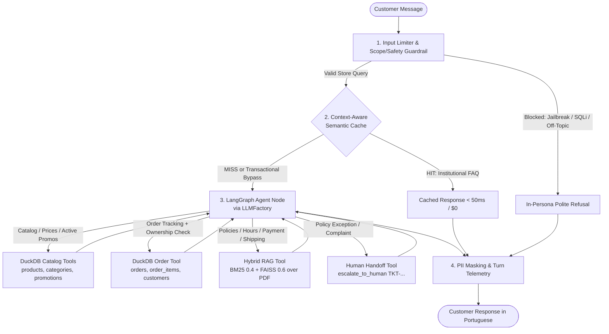

# Empório da Música — Intelligent Customer Support Agent

> **Artefact Technical Challenge — AI Engineer – Full-Stack para Aplicações com IA Generativa**  
> **Candidate:** Willian Arakaki  
> **Public GitHub Repository:** [https://github.com/willarakaki/desafio-tecnico-ai-eng-artefact](https://github.com/willarakaki/desafio-tecnico-ai-eng-artefact)
> 
> A clean, tool-grounded Python customer support agent built for **Empório da Música** (a musical instruments store in Campo Grande/MS, Brazil). Designed around **logical reasoning and pragmatic simplicity**: every architectural element solves a concrete data or reliability requirement discovered in the store's files, using lightweight, in-memory Python primitives with **zero external database or infrastructure dependencies**.

[](https://www.python.org/downloads/)
[](https://langchain-ai.github.io/langgraph/)
[](https://duckdb.org/)
[](src/rag/)
[](https://github.com/willarakaki/desafio-tecnico-ai-eng-artefact/actions)
[](https://github.com/astral-sh/ruff)
[](LICENSE)

---

## Table of Contents
1. [Problem Statement & Pragmatic Design Philosophy](#1-problem-statement--pragmatic-design-philosophy)
2. [System Architecture & Execution Flow](#2-system-architecture--execution-flow)
3. [How to Run the Project (Environment, Model Providers & Commands)](#3-how-to-run-the-project-environment-model-providers--commands)
   - [3.1. Environment Setup & Installation (`uv` or `pip`)](#31-environment-setup--installation-uv-or-pip)
   - [3.2. Configuring & Switching Model Providers (`gemini`, `openai`, `ollama`)](#32-configuring--switching-model-providers-gemini-openai-ollama)
   - [3.3. Commands to Run (CLI, Streamlit UI, API, Docker & Tests)](#33-commands-to-run-cli-streamlit-ui-api-docker--tests)
4. [Technical Decisions & Logical Justifications](#4-technical-decisions--logical-justifications)
   - [4.1. Agent Framework & Approach (Single-Graph LangGraph + Function Calling)](#41-agent-framework--approach-single-graph-langgraph--function-calling)
   - [4.2. Model & Provider Choice (`LLMFactory`, Sampling & Unified Agent Node)](#42-model--provider-choice-llmfactory-sampling--unified-agent-node)
   - [4.3. Data Treatment & Structured Lookup (In-Memory DuckDB vs. Text-to-SQL)](#43-data-treatment--structured-lookup-in-memory-duckdb-vs-text-to-sql)
   - [4.4. Policy Retrieval Architecture (In-Memory Hybrid RAG: BM25 + FAISS)](#44-policy-retrieval-architecture-in-memory-hybrid-rag-bm25--faiss)
   - [4.5. Prompt Strategy, Store Persona & Anti-Hallucination Rules](#45-prompt-strategy-store-persona--anti-hallucination-rules)
   - [4.6. Conversation History Persistence (`MemorySaver` by Session)](#46-conversation-history-persistence-memorysaver-by-session)
   - [4.7. Interaction Interfaces (CLI, Streamlit UI & REST/SSE API)](#47-interaction-interfaces-cli-streamlit-ui--restsse-api)
   - [4.8. Pragmatic Safeguards (Scope Guardrails, LGPD Privacy, Semantic Cache & HITL)](#48-pragmatic-safeguards-scope-guardrails-lgpd-privacy-semantic-cache--hitl)
   - [4.9. Documented Assumptions on Ambiguous Cases](#49-documented-assumptions-on-ambiguous-cases)
5. [Interaction Examples (`transcripts/`)](#5-interaction-examples-transcripts)
6. [Known Limitations & What Would Be Done With More Time](#6-known-limitations--what-would-be-done-with-more-time)
7. [AI Coding Assistant Disclosure & Engineering Workflow](#7-ai-coding-assistant-disclosure--engineering-workflow)
8. [Repository Structure](#8-repository-structure)

---

## 1. Problem Statement & Pragmatic Design Philosophy

**Empório da Música** is a musical instruments store in Campo Grande/MS whose support team is overloaded with repetitive customer questions: store opening hours, physical address, payment/installment rules, product prices and stock availability, order tracking, and return/warranty policies.

### Solving the Problem in the Simplest Reliable Way
Rather than over-engineering with external databases, message brokers, or multi-agent swarms, I analyzed the actual provided datasets (`data/*.csv` and `data/políticas_da_loja.pdf`) first and chose the **simplest self-contained Python mechanism** capable of solving each real problem accurately:

| Requirement in Scenario | Why Naive LLM Approaches Fail | Simplest Reliable Solution Chosen | Complex Infra Intentionally Avoided |
| :--- | :--- | :--- | :--- |
| **Exact prices, stock & order status** (`data/*.csv`) | Stuffing CSVs into prompts wastes tokens and miscounts filters; free-form Text-to-SQL risks syntax errors and SQL injection. | **In-memory DuckDB** + **4 typed Python functions** (`search_products`, `get_product_details`, `get_active_promotions`, `get_order_status`). | External PostgreSQL/MySQL servers, ORMs, or complex Text-to-SQL agents. |
| **Store rules, hours & deadlines** (`políticas_da_loja.pdf`) | Pure vector search often misses exact numbers (`CEP 79202-333`, `7 dias`, `5%` PIX, `12x`); pure keyword search misses paraphrases. | **In-memory Hybrid RAG** combining `rank-bm25` (`0.4`) + local `FAISS` (`0.6`) over section-split PDF chunks. | External vector DB servers (Pinecone, Qdrant, Weaviate) or heavy GraphRAG. |
| **Knowing when to query CSV vs. PDF vs. both** | Rigid `if/else` routers break when a user asks about an order *and* return rules in the same message. | **Single LangGraph tool-calling loop** (`agent` $\leftrightarrow$ `tools`, bounded to `recursion_limit=6`). | Multi-agent hierarchies or brittle custom `while` loops. |
| **Out-of-scope & unsafe inputs** | Calling an LLM judge on every turn doubles latency and API cost. | **Lightweight Python regex/keyword guardrail** + clear System Prompt scope boundaries. | Dedicated GPU guardrail servers or double-LLM calls per turn. |
| **Repeated FAQ questions** (hours, address) | Re-running LLM + embeddings on identical FAQs adds ~1s latency and unnecessary token cost. | **In-memory cosine similarity cache** (`>= 0.92`) with strict bypass for orders, stock, and PII. | External Redis/Memcached clusters. |

**Result:** The entire project runs locally in seconds with `uv sync` (or `pip install -r requirements.txt`) and a single API key—or **100% free and offline** with Ollama.

---

## 2. System Architecture & Execution Flow



---

## 3. How to Run the Project (Environment, Model Providers & Commands)

### Prerequisites
- **Python 3.11+** (or **Docker** if running via container).
- One model provider configured in `.env`:
  - **Google Gemini** (`GEMINI_API_KEY` — default, free tier available on Google AI Studio), **or**
  - **OpenAI** (`OPENAI_API_KEY`), **or**
  - **Ollama** (free local execution, no API key required).

---

### 3.1. Environment Setup & Installation (`uv` or `pip`)

```bash
# 1. Clone the repository
git clone https://github.com/willarakaki/desafio-tecnico-ai-eng-artefact.git
cd desafio-tecnico-ai-eng-artefact

# 2. Copy the environment variable template
cp .env.example .env          # Windows PowerShell: Copy-Item .env.example .env

# 3. Install dependencies using uv (Recommended)
uv venv --python 3.11
source .venv/bin/activate     # Windows PowerShell: .\.venv\Scripts\Activate.ps1
uv sync
```

<details>
<summary><strong>Alternative installation using standard <code>pip</code></strong></summary>

```bash
python -m venv .venv
source .venv/bin/activate     # Windows PowerShell: .\.venv\Scripts\Activate.ps1
pip install -r requirements.txt
```
</details>

---

### 3.2. Configuring & Switching Model Providers (`gemini`, `openai`, `ollama`)

Edit `.env` to choose your preferred provider via `LLM_PROVIDER` (validated centrally in `src/config.py`):

#### Option 1 — Google Gemini (Default)
```env
LLM_PROVIDER=gemini
GEMINI_API_KEY=your_gemini_api_key_here
GEMINI_ROUTER_MODEL=gemini-3.5-flash-lite
GEMINI_SYNTHESIZER_MODEL=gemini-3.5-flash-lite
GEMINI_EMBEDDING_MODEL=models/gemini-embedding-001
```
*Note: `gemini-3.5-flash-lite` is the current universally accessible Flash-Lite model on Google AI Studio with a generous free tier (zero cost for prompt and output tokens on standard free quota). `models/gemini-embedding-001` remains fully supported through May 2028.*

#### Option 2 — OpenAI
```env
LLM_PROVIDER=openai
OPENAI_API_KEY=your_openai_api_key_here
OPENAI_ROUTER_MODEL=gpt-4o-mini
OPENAI_SYNTHESIZER_MODEL=gpt-4o-mini
OPENAI_EMBEDDING_MODEL=text-embedding-3-small
```

#### Option 3 — Local Open-Weights via Ollama (100% Free, No API Key)
```bash
# Pull local chat and embedding models first:
ollama pull qwen2.5:7b
ollama pull nomic-embed-text
```
```env
LLM_PROVIDER=ollama
OLLAMA_BASE_URL=http://localhost:11434
OLLAMA_ROUTER_MODEL=qwen2.5:7b
OLLAMA_SYNTHESIZER_MODEL=qwen2.5:7b
OLLAMA_EMBEDDING_MODEL=nomic-embed-text
```

<details>
<summary><strong>Optional Environment Variables (Cache, Rate Limit & LangSmith Tracing)</strong></summary>

```env
SEMANTIC_CACHE_THRESHOLD=0.92        # Cosine similarity threshold for FAQ cache hits
RATE_LIMIT_MAX_REQUESTS=15           # Max messages per 60s window per session_id
RATE_LIMIT_WINDOW_SECONDS=60
MAX_INPUT_CHARS=2000                 # Max input length safeguard

# Optional LangSmith observability:
LANGCHAIN_TRACING_V2=true
LANGCHAIN_API_KEY=your_langsmith_api_key_here
LANGCHAIN_PROJECT=emporio-da-musica-agent
```
</details>

---

### 3.3. Commands to Run (CLI, Streamlit UI, API, Docker & Tests)

```bash
# 1. Interactive Terminal CLI (simplest way to chat in terminal; supports /metrics, /clear, /exit)
uv run python cli.py

# 2. Streamlit Web UI with live telemetry & HITL sidebar (http://localhost:8501)
uv run streamlit run app.py

# 3. FastAPI REST & SSE Server with Swagger UI (http://localhost:8000/docs)
uv run uvicorn src.api.server:app --host 0.0.0.0 --port 8000 --reload

# 4. Run via Docker Compose in 1 command (starts both FastAPI on :8000 and Streamlit on :8501)
docker compose up --build

# 5. Run the automated test suite (170 deterministic unit & integration tests)
uv run pytest -v

# 6. Run code quality & formatting checks
uv run ruff check .

# 7. Regenerate the 5 conversation transcripts in transcripts/
uv run python scripts/generate_transcripts.py
```

---

## 4. Technical Decisions & Logical Justifications

### 4.1. Agent Framework & Approach (Single-Graph LangGraph + Function Calling)
- **Considered Alternatives:**
  1. *Hardcoded Intent Classifier (`if/else` router):* Fails on composite customer questions (e.g., *"Meu pedido #4 chegou com defeito no cavalete, ainda consigo trocar na loja?"*, which requires **both** CSV order lookup and PDF warranty policy lookup in the same turn).
  2. *Unconstrained ReAct / Multi-Agent Framework (CrewAI/AutoGen):* Adds unnecessary prompt overhead, latency, and risk of infinite tool loops for a single-domain store assistant.
- **Chosen Approach:** A **single-agent LangGraph `StateGraph`** (`src/agent/graph.py`) combining native LLM **Function Calling** with a bounded tool loop (`recursion_limit = 6`). The model can invoke one or multiple tools in parallel per turn, inspect deterministic outputs, and synthesize a grounded answer.

---

### 4.2. Model & Provider Choice (`LLMFactory`, Sampling & Unified Agent Node)
- **Model Efficiency & Cost Profile:** For customer support, low latency and reliable structured tool calling matter more than frontier reasoning cost. Compact flash/mini class models (`gemini-3.5-flash-lite`, `gpt-4o-mini`, or local `qwen2.5:7b`) provide sub-second tool selection at fractions of a cent per turn (~$0.05 to $1.50 per 1,000 turns depending on context length and whether Google's free tier, paid tier, or OpenAI is used).
- **Sampling Parameters across Providers:**
  - On OpenAI (`gpt-4o-mini`) and Ollama (`qwen2.5`), the factory supports temperature tuning (`0.0` for routing, `0.2` for synthesis).
  - On Google Gemini (`gemini-3.5-flash-lite`), modern Gemini API specifications deprecate sampling parameters (`temperature`, `top_p`, `top_k`) in favor of standardized, stable tool-calling inference.
- **Factory Flexibility vs. Unified LangGraph Node:** While `src/agent/llm_factory.py` provides separate factory methods (`get_router_llm` and `get_synthesizer_llm`) to accommodate multi-model architectures, `src/agent/graph.py` pragmatically unifies tool calling and consultative response generation into a **single compiled agent node** (`self.model = model or LLMFactory().get_synthesizer_llm()`). This avoids the latency penalty of two sequential LLM calls per turn while preserving decoupled provider configuration.
- **Resilience:** When secondary credentials are configured, `.with_fallbacks()` automatically fails over across providers on HTTP `429`/`500` errors; if all providers fail, the agent degrades safely by opening an auditable human support ticket.

---

### 4.3. Data Treatment & Structured Lookup (In-Memory DuckDB vs. Text-to-SQL)
Before writing any code, I profiled all **6 operational CSV files** (`categories.csv` [9 rows], `products.csv` [65 rows], `promotions.csv` [25 rows], `customers.csv` [50 rows], `orders.csv` [20 rows], `order_items.csv` [22 rows]) and uncovered concrete data edge cases that guided the data treatment in `src/database/duckdb_manager.py`:

1. **Filename & Text Normalization:** Strips the `desafio_tecnico_ai_eng - ` filename prefix into clean relational tables, trims whitespace, and registers a custom `strip_accents` SQL macro so queries like `"violao"` match `"Violões"` seamlessly.
2. **Stock vs. Status Contradictions:** Profiling revealed `product_id=96` (*Giannini GF-3D*) has `status='active'` with `stock_quantity=0`, whereas `product_id=136` (*Ibanez Bass 2X*) has `status='discontinued'` despite `stock_quantity=13`, and `product_id=130` has `status='coming_soon'` (`stock=2`). Consequently, `in_stock_only=True` strictly filters `status = 'active' AND stock_quantity > 0`.
3. **Active vs. Expired Promotions:** Only **4 of 25** rows in `promotions.csv` have `is_active = 1` (`product_id` `90`, `94`, `121`, `127`). The remaining 21 rows—including *Takamine GD20* (`product_id=95`, `12%`, `is_active=0`)—are expired historical campaigns. The catalog tools explicitly separate active promotions from expired ones so the agent never grants an inactive discount.
4. **Empty Categories & Spec Variance:** Categories `6`, `7`, and `8` (wind and orchestral instruments) have `0` rows in `products.csv`, and rows `135..144` contain slight naming differences between `name`, `description`, and JSON `specs`. Search queries match across both `name` and `description` and return verbatim attributes.
5. **Typed Pydantic v2 Tools instead of Free-Form SQL:** Rather than letting the LLM write raw SQL, I exposed 4 strictly validated tools (`search_products`, `get_product_details`, `get_active_promotions`, `get_order_status`) using `100%` parameterized queries—eliminating SQL syntax errors and SQL injection by construction.

---

### 4.4. Policy Retrieval Architecture (In-Memory Hybrid RAG: BM25 + FAISS)
- **Why Chunk by Section Across Pages?** `data/políticas_da_loja.pdf` (8 pages, *Manual de Políticas e Procedimentos v2.1*) has tables and bullet lists in Sections `5.2` (shipping), `7.2` (WhatsApp conduct), and `9` (LGPD) that split across page boundaries. `src/rag/pdf_loader.py` concatenates text with page-span metadata before splitting by numbered section headings (`1.` through `10.`), keeping every rule attached to its heading context.
- **Why Hybrid BM25 (`0.4`) + FAISS (`0.6`)?** Store policies contain both exact tokens (`CEP 79202-333`, `09:00 às 18:00`, `7 dias corridos`, `30 dias`, `90 dias`, `5%` PIX, `R$ 500,00` free local shipping) and semantic concepts (*"me arrependi da compra"*, *"meu instrumento caiu no chão"*). Combining a custom accent-folded Portuguese BM25 tokenizer with FAISS dense embeddings in `src/rag/hybrid_retriever.py` captures both exact numbers and paraphrased customer questions without any external vector DB service.

---

### 4.5. Prompt Strategy, Store Persona & Anti-Hallucination Rules
Implemented in `src/agent/prompts.py`, the System Prompt was engineered around three practical principles:
1. **Store-Aligned Persona (Section 7 of Policy Manual):** Warm, consultative musical instrument specialist in Campo Grande/MS who communicates naturally in Brazilian Portuguese and understands instrument construction (spruce/cedar tops, mahogany/sapele bodies, nylon vs. steel strings) without inventing facts.
2. **Persona Grounding vs. Dynamic Tool Lookup:** While basic store identity (physical address, opening hours, instrument-only scope) is present in the System Prompt for immediate persona consistency, detailed normative rules (returns, warranty exclusions, freight tiers, installment minimums) are **deliberately omitted** from the prompt with a mandatory directive to call `consult_store_policies`. Furthermore, when customers ask about address or opening hours, the agent dynamically invokes `consult_store_policies` (or hits the Semantic Cache) to guarantee complete factual groundedness against the official PDF manual (as demonstrated in Transcript 03).
3. **Explicit Negative Constraints:**
   - Never guess prices, stock, order status, or policy deadlines without tool calls.
   - **Non-cumulative discounts:** The 5% PIX discount never stacks onto an active promotional price.
   - **No loose accessories:** Politely clarify that Empório da Música sells complete instruments only (not strings, picks, cables, pedals, amps, or cases).
   - **Out-of-scope refusal:** Politely decline unrelated topics (cooking recipes, politics, coding) in persona.
   - **Honest human escalation:** Never claim to transfer a case to a human without actually invoking `escalate_to_human` (enforced both in prompt and via a deterministic post-check in `graph.py`).

---

### 4.6. Conversation History Persistence (`MemorySaver` by Session)
- **Why Implement Persistence?** Real support dialogues rely on conversational context (e.g., asking *"Quais violões até R$ 1.000?"* followed by *"Qual desses dois você recomenda para iniciante?"*, or providing an order number first and confirming email/phone on the next message).
- **How It Works:** LangGraph's in-memory `MemorySaver` stores message state per `session_id` (`thread_id`), preserving multi-turn continuity across CLI, Streamlit, and API calls while requiring zero database setup.

---

### 4.7. Interaction Interfaces (CLI, Streamlit UI & REST/SSE API)
To make testing effortless across different evaluation preferences, the exact same `EmporioAgent` core powers:
- **Rich CLI (`cli.py`):** Fastest terminal chat loop with inline tool/latency/cache badges.
- **Streamlit UI (`app.py`):** Clean visual chat with an observability sidebar inspecting invoked tools, cache hits, token cost, and HITL tickets in real time.
- **FastAPI Backend (`src/api/server.py`):** Exposes `POST /api/chat`, `POST /api/chat/stream` (standard SSE + Vercel AI SDK stream compatibility), `GET /api/health`, and `GET /api/metrics` with Swagger docs at `/docs`.

<details>
<summary><strong>Optional Frontend Integration Example (React / Next.js with Vercel AI SDK)</strong></summary>

```tsx
"use client";
import { useChat } from "@ai-sdk/react";

export default function EmporioChat() {
  const { messages, input, handleInputChange, handleSubmit, isLoading } = useChat({
    api: "http://localhost:8000/api/chat/stream",
    experimental_prepareRequestBody: ({ messages }) => ({
      query: messages.at(-1)?.content ?? "",
      session_id: "customer-session-123",
      format: "vercel",
    }),
  });
  // Render messages & form...
}
```
</details>

---

### 4.8. Pragmatic Safeguards (Scope Guardrails, LGPD Privacy, Semantic Cache & HITL)
Each safeguard is a compact, single-module Python component solving a realistic support risk:
- **Pre-LLM Guardrail & Rate Limiter (`src/security/`):** Blocks prompt-injection/jailbreak overrides, SQLi patterns, excessive request bursts, and clear off-domain queries in `<5ms` before spending API tokens.
- **Anti-IDOR Order Verification (`src/tools/order_tools.py`):** Prevents exposing another customer's address/city/tracking code when someone only types `"Qual o status do pedido #5?"`—requiring matching customer email, phone, or registered name alongside `order_id`.
- **LGPD PII Redaction (`src/security/pii_anonymizer.py`):** Masks personal CPF, email, and phone numbers in telemetry/logs while whitelisting official store contacts (`(67) 3341-4444`, `(67) 3321-4500`, `contato@emporiodamusica.com.br`).
- **Context-Aware Semantic Cache (`src/cache/semantic_cache.py`):** Caches static institutional FAQs (`similarity >= 0.92`) for `<50ms` responses, while **strictly bypassing** any query involving orders, live stock, prices, or PII (`BYPASS_TRANSACTIONAL`).
- **Human-in-the-Loop Escalation (`src/tools/hitl_tools.py`):** Aligned with Section 10 of `políticas_da_loja.pdf` (*"Em caso de dúvida sobre a aplicação de qualquer política, consulte a gerência"*), `escalate_to_human` creates a structured `TKT-...` handoff ticket (`24 horas úteis` SLA) when customers request policy exceptions or express severe dissatisfaction.
- **Turn Telemetry (`src/observability/telemetry.py`):** Records latency, cache status, invoked tools, token usage, and estimated USD cost on every turn.

---

### 4.9. Documented Assumptions on Ambiguous Cases
Per the challenge guideline (*"assuma uma interpretação razoável, documente a suposição no README e siga em frente"*), I documented the following assumptions:
1. **Order Identity Verification Without CPF Column:** `customers.csv` contains `name`, `phone`, `email`, and `city`, but no `cpf` column (and `bruno.martins@jmail.com` appears on two customer IDs: `11` and `43`). I assumed `order_id` paired with matching `email`, digits-normalized `phone`, or `name` as the verification key for order lookups, while still supporting CPF masking in chat logs for LGPD compliance if a customer types their CPF voluntarily.
2. **Product Availability Definition:** Because `products.csv` contains both `active` items with `0` stock (`product_id=96`) and `discontinued` items with positive leftover stock (`product_id=136`), I assumed that *"available products"* recommended to customers must satisfy **both** `status = 'active'` AND `stock_quantity > 0`, while direct lookups (`get_product_details`) transparently report discontinued or out-of-stock status.
3. **Language Split:** Following the submission instructions (*"All responses must be in English!"*) while respecting the Brazilian store scenario, all documentation, code, schemas, and architectural explanations are written in **English**, whereas the agent's customer-facing persona and the simulated customer dialogues in `transcripts/` are in **Brazilian Portuguese**.
4. **Using All Provided Files:** Although using every table was optional, all 6 CSV tables exhibit `100%` referential integrity and directly enrich customer answers (joining `orders` + `order_items` + `products` + `customers`, and cross-checking `products` + `categories` + `promotions`), so all 6 CSVs and the full 8-page PDF were integrated.

---

## 5. Interaction Examples (`transcripts/`)

Five multi-turn conversations were generated through the agent pipeline (`scripts/generate_transcripts.py`) and saved in [`transcripts/`](transcripts/), covering all suggested challenge prompts plus non-trivial multi-source edge cases:

1. **[`transcripts/01_catalogo_violoes_ate_1000.md`](transcripts/01_catalogo_violoes_ate_1000.md)** — *Catalog Search Under R$ 1,000 & Musical Advice:*  
   Queries available acoustic guitars up to R$ 1,000 (`search_products`), compares tonewoods between *Yamaha C40M II* and *Strinberg SD200C* (`get_product_details`), advises on nylon vs. steel strings for beginners, and politely explains that loose picks/strings/cases are outside the store's scope.
2. **[`transcripts/02_preco_especifico_takamine_gd20.md`](transcripts/02_preco_especifico_takamine_gd20.md)** — *Specific Price Lookup, Expired Promotion & Payment Rules:*  
   Looks up *Takamine GD20* (`get_product_details`), transparently explains that its historical 12% discount is expired (`is_active=0`), states current price (`R$ 2,890.00`, 4 units in stock), and consults `políticas_da_loja.pdf` (`consult_store_policies`) to calculate the 5% PIX upfront option and 12x interest-free installment rules.
3. **[`transcripts/03_informacoes_gerais_e_endereco.md`](transcripts/03_informacoes_gerais_e_endereco.md)** — *Store Address, Hours & Semantic Cache `HIT`:*  
   Retrieves the Campo Grande/MS address (`Rua 14 de Maio, 3200`) and opening hours from the PDF on Turn 1, serves a paraphrased follow-up via **Semantic Cache `HIT` (`3.4 ms`, `0` tokens, `$0.00`)** on Turn 2, and answers local Campo Grande courier delivery rules (`> R$ 500` free shipping) on Turn 3.
4. **[`transcripts/04_politica_devolucao_pedido_e_hitl.md`](transcripts/04_politica_devolucao_pedido_e_hitl.md)** — *Non-Trivial Multi-Source Scenario (Order CSV + Return Policy PDF + HITL):*  
   Checks `Order #4` (*Lucas Mendes*, `BYPASS_TRANSACTIONAL`) in DuckDB, applies the PDF rules distinguishing the 30-day store defect exchange from the 90-day statutory CDC warranty, and invokes `escalate_to_human` when the customer requests a management exception for an upcoming weekend performance—generating protocol `TKT-...` with PII masking.
5. **[`transcripts/05_guardrails_fora_de_escopo_e_jailbreak.md`](transcripts/05_guardrails_fora_de_escopo_e_jailbreak.md)** — *Out-of-Scope Refusal, Jailbreak Blocking & Recovery:*  
   Politely declines an off-topic cooking recipe question, blocks a `SYSTEM OVERRIDE` prompt-extraction attempt in `3.5 ms` at zero LLM cost, and seamlessly resumes consultative ukulele recommendations when the customer returns to musical instruments.

---

## 6. Known Limitations & What Would Be Done With More Time

### 6.1. Current Known Limitations (Honest Prototype Trade-Offs)
To keep setup simple, fast, and self-contained for evaluation, the prototype has the following documented limitations:
- **Offline Mock Testing vs. Live LLM Non-Determinism:** All 170 automated pytest tests run in CI using `DeterministicAgentChatModel` and `DeterministicMockEmbeddings`. This ensures ultra-fast (<40s), zero-cost, and non-flaky verification of graph transitions, DuckDB queries, PII masking, and cache logic, but does not evaluate non-deterministic generative drift or live LLM instruction-following under real API traffic.
- **Heuristic Retrieval Weights & Cache Threshold:** The Hybrid RAG weights (`BM25 = 0.4`, `FAISS = 0.6`) and Semantic Cache threshold (`similarity >= 0.92`) were selected based on domain heuristics (exact lexical match for numeric codes/deadlines vs. dense semantic match for natural language). They have not yet undergone systematic Bayesian optimization or Grid Search over a labeled ground-truth evaluation split.
- **Gemini 3.5 Flash-Lite Default Thinking Level:** Gemini 3.5 Flash-Lite defaults to `minimal` thinking effort. For high-complexity autonomous planning and multi-step agentic workflows, Google officially recommends elevating the thinking level to `medium` or `high` to maximize tool-calling precision.
- **LGPD Compliance on the Free Tier:** Under Google AI Studio's standard Free Tier terms of service, prompt inputs and outputs may be reviewed and used to improve Google products. While the pipeline applies client-side regex masking to CPF, phone, and email before telemetry logging, commercial deployment requiring strict LGPD compliance must utilize Google Cloud Vertex AI (Paid Tier) or local open-weights execution (Ollama) to guarantee zero third-party data retention.
- **In-Memory Ephemeral State (`MemorySaver` & `SemanticCache`):** Conversation history and cached FAQ embeddings live in Python process memory. Restarting the application clears active sessions and cached embeddings, and state is not shared across multiple worker processes.
- **Static Read-Only CSV Snapshot:** DuckDB loads `data/*.csv` into memory on startup. While fast and deterministic, stock deductions, order creations, or live ERP updates are not persisted back to a transactional database.
- **Cold-Start Policy Embedding (~1–2s on First Query):** The 8-page policy PDF is embedded into local FAISS upon initial retriever initialization rather than loaded from a pre-persisted vector index.

### 6.2. What Would Be Done With More Time
With additional time to evolve this prototype into an enterprise production system for Empório da Música, I would prioritize:
1. **Persistent Session Memory & Shared Cache:** Replace `MemorySaver` with `AsyncPostgresSaver` and move the Semantic Cache to **Redis Vector Search** with TTLs and automatic cache invalidation whenever product prices or promotions change.
2. **Automated LLM Quality Evaluation (Ragas / DeepEval in CI):** Complement the 170 deterministic unit/integration tests with an automated evaluation dataset of 100+ realistic Portuguese customer conversations measuring *Faithfulness*, *Answer Relevancy*, and *Tool Selection Precision* on prompt/model changes.
3. **WhatsApp Business Cloud API Integration:** Connect the FastAPI server to Meta's official WhatsApp webhook (including audio message transcription for voice notes, which are common in Brazilian retail WhatsApp support) and connect `escalate_to_human` directly to the store team's shared inbox/CRM.
4. **Live ERP Synchronization & Pre-Built Vector Index:** Sync DuckDB/PostgreSQL with the store's live inventory/POS system and persist FAISS embeddings on build to eliminate cold-start indexing latency.
5. **Lightweight Local Classifier for Edge-Case Guardrails:** Add a small dedicated safety model (e.g., *Llama Prompt Guard 2*) for low-latency semantic jailbreak detection without extra commercial LLM calls.

---

## 7. AI Coding Assistant Disclosure & Engineering Workflow

In accordance with the challenge deliverable guidelines, I disclose the use of **Google Antigravity** as my AI coding assistant during development, operating under a structured, human-led **Spec-Driven + Test-Driven Development (TDD)** workflow.

### Models Used in Google Antigravity
- **Gemini 3.8 Flash (High):** Primary model utilized for rapid TDD test generation, Pydantic v2 schema scaffolding, and code formatting with sub-second latency.
- **Gemini 4 Argon (High):** Utilized for deep architectural reasoning, cross-framework dependency audits (LangGraph + FastAPI SSE + DuckDB macros), and security review.

### Human-in-the-Loop Governance & Concrete Corrections
Rather than treating AI as an autonomous black-box code generator, I exercised strict human architectural control. Three concrete examples where I corrected or rejected initial AI proposals include:

1. **Enforcing Anti-IDOR Security in Order Tracking (Commit `692245f`):**  
   *AI Initial Output:* The assistant initially generated a simple order lookup tool where any anonymous user providing only an order number (`#5`) would receive full customer name, city, items, and tracking code.  
   *My Intervention:* I rejected this insecure design and enforced anti-IDOR authentication in `src/tools/order_tools.py` and `src/agent/prompts.py`: requiring the customer to provide their matching email or registered phone before disclosing sensitive order details, preventing unauthorized horizontal data leakage.

2. **Resolving Presidio PII Masking False Positives on Store Contacts (Commit `692245f`):**  
   *AI Initial Output:* The initial PII anonymizer applied aggressive regex patterns that redacted the store's own official contact information (`(67) 3341-4444`, `(67) 3321-4500`, and `contato@emporiodamusica.com.br`) as `[PHONE_REDACTED]` and `[EMAIL_REDACTED]`.  
   *My Intervention:* I introduced explicit whitelisting in `src/security/pii_anonymizer.py` (`INSTITUTIONAL_PHONES_DIGITS` and `INSTITUTIONAL_EMAILS`) so the agent can freely provide store contact channels while redacting customer PII.

3. **LangSmith Environment Collision & Gemini `thought_signature` Patch (Commit `fdac9ca`):**  
   *AI Initial Output:* The initial observability configuration exported `LANGSMITH_AGENT_ID` into the environment, causing an `EnvAddressError` collision with project addresses in LangSmith. Furthermore, sequential Gemini 3.x tool calls dropped required cryptographic `thought_signature` bytes, causing Google API 400 errors.  
   *My Intervention:* I diagnosed the collisions, sanitized environment variable propagation in `src/config.py`, and authored `_apply_gemini_thought_signature_patch` in `src/agent/llm_factory.py` to preserve thought signatures across multi-turn tool calling.

---

## 8. Repository Structure

```text
desafio-tecnico-ai-eng-artefact/
├── .agents/
│   └── skills/
│       └── tdd-commit-gate/SKILL.md  # Custom agentic TDD quality gate skill
├── .github/
│   └── workflows/ci.yml              # GitHub Actions CI (Ruff + 170 Pytest tests)
├── data/
│   ├── desafio_tecnico_ai_eng - categories.csv
│   ├── desafio_tecnico_ai_eng - customers.csv
│   ├── desafio_tecnico_ai_eng - order_items.csv
│   ├── desafio_tecnico_ai_eng - orders.csv
│   ├── desafio_tecnico_ai_eng - products.csv
│   ├── desafio_tecnico_ai_eng - promotions.csv
│   └── políticas_da_loja.pdf         # Internal store policy & procedure manual (8 pages)
├── docs/
│   └── architecture.md               # Detailed system architecture & mapped data dictionary
├── scripts/
│   └── generate_transcripts.py       # Script generating the 5 multi-turn transcripts
├── src/
│   ├── agent/                        # LangGraph state machine, LLMFactory & prompts
│   ├── api/                          # FastAPI REST & SSE server (/docs, /api/chat)
│   ├── cache/                        # Context-aware Semantic Cache + bypass rules
│   ├── database/                     # In-memory DuckDB ingestion & text normalization
│   ├── observability/                # Turn latency, token, and FinOps cost telemetry
│   ├── rag/                          # Section-aware PDF loader + BM25/FAISS retriever
│   ├── security/                     # Rate limiter, input guardrails & LGPD PII masker
│   ├── tools/                        # Typed Pydantic v2 tools (catalog, orders, RAG, HITL)
│   └── config.py                     # Centralized pydantic-settings configuration
├── tests/                            # 170 unit & integration tests
├── transcripts/                      # 5 conversation examples (.md) with tool traces
├── .env.example                      # Environment variable template
├── AGENTS.md                         # Workspace engineering & data governance rules
├── app.py                            # Streamlit chat UI with observability sidebar
├── cli.py                            # Rich interactive terminal interface
├── Dockerfile                        # Multi-stage lightweight container
├── docker-compose.yml                # Multi-service Docker Compose (FastAPI + Streamlit)
├── LICENSE                           # Official MIT license
├── pyproject.toml                    # Project metadata, dependencies & tool configs
├── requirements.txt                  # Standard pip dependency manifest
├── TASKS.md                          # Granular roadmap & execution milestones
├── uv.lock                           # Deterministic dependency lockfile
└── README.md                         # Project documentation & technical justifications
```

---

## License

Released under the **[MIT License](LICENSE)**. Developed for the **Artefact Brazil — AI Engineer Technical Challenge**.
