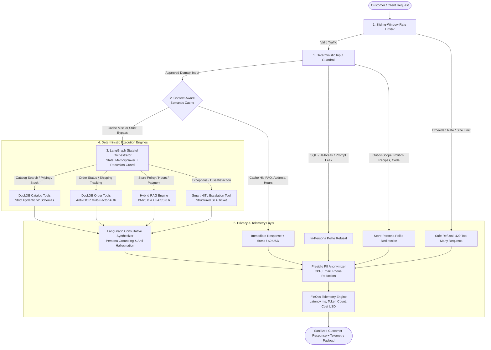

# Empório da Música — Enterprise Intelligent Support Agent

[](https://www.python.org/downloads/)
[](https://langchain-ai.github.io/langgraph/)
[](https://duckdb.org/)
[](https://fastapi.tiangolo.com/)
[](https://streamlit.io/)
[](https://www.docker.com/)
[](https://github.com/astral-sh/ruff)
[](tests/)
[](LICENSE)

> **Artefact Technical Challenge — AI Engineer**  
> An enterprise-grade, deterministic customer support agent engineered for **Empório da Música** (a musical instruments store in Campo Grande/MS, Brazil). Built under Artefact's core operational principle: *"If not used, it is useless"*, bridging the consultative empathy of Large Language Models (LLMs) with the deterministic reliability of in-memory relational queries, hybrid information retrieval, runtime safety guardrails, and FinOps cost observability.

---

## Table of Contents
1. [Executive Overview & Business Context](#1-executive-overview--business-context)
2. [System Architecture & Layered Execution Flow](#2-system-architecture--layered-execution-flow)
3. [Quickstart & Execution Guide](#3-quickstart--execution-guide)
   - [Option A: 1-Command Docker Deployment](#option-a-1-command-docker-deployment)
   - [Option B: Local Setup with `uv` or `pip`](#option-b-local-setup-with-uv-or-pip)
4. [Interaction Interfaces Tour](#4-interaction-interfaces-tour)
   - [Streamlit Observability UI](#41-streamlit-observability-ui)
   - [Rich Interactive CLI](#42-rich-interactive-cli)
   - [FastAPI REST & SSE Streaming Backend](#43-fastapi-rest--sse-streaming-backend)
   - [React / Next.js Vercel AI SDK Integration Snippet](#44-react--nextjs-vercel-ai-sdk-integration-snippet)
5. [In-Depth Technical Justifications](#5-in-depth-technical-justifications)
   - [LangGraph Orchestrator vs. Sequential Chains](#51-langgraph-orchestrator-vs-sequential-chains)
   - [DuckDB Parameterized Tools vs. Raw Text-to-SQL](#52-duckdb-parameterized-tools-vs-raw-text-to-sql)
   - [Hybrid Policy Retrieval (BM25 + FAISS)](#53-hybrid-policy-retrieval-bm25--faiss)
   - [Context-Aware Semantic Cache with Transactional & PII Bypass](#54-context-aware-semantic-cache-with-transactional--pii-bypass)
   - [Defense-in-Depth & LGPD Presidio PII Masking](#55-defense-in-depth--lgpd-presidio-pii-masking)
   - [Multi-Provider Resilience & Automatic Fallback](#56-multi-provider-resilience--automatic-fallback)
   - [Smart Human-in-the-Loop (HITL) Escalation](#57-smart-human-in-the-loop-hitl-escalation)
6. [FinOps & Observability](#6-finops--observability)
7. [AI Coding Assistant Disclosure (Google Antigravity Workflow)](#7-ai-coding-assistant-disclosure-google-antigravity-workflow)
8. [Multi-Turn Interaction Transcripts (`transcripts/`)](#8-multi-turn-interaction-transcripts-transcripts)
9. [Known Limitations & Production Roadmap](#9-known-limitations--production-roadmap)
10. [Repository Structure](#10-repository-structure)

---

## 1. Executive Overview & Business Context

**Empório da Música** is a physical musical instruments store and regional e-commerce hub founded in 2008 in Campo Grande/MS, Brazil. The store's internal sales and support staff face a high volume of repetitive inbound inquiries across digital channels (primarily WhatsApp), causing operational bottlenecks and delayed response times:

- **Institutional FAQs:** Store address (`Rua 14 de Maio, 3200`), business hours, and payment rules.
- **Transactional Inquiries:** Live inventory, exact pricing, promotional discounts, and order fulfillment status.
- **Policy Queries:** Return rights (CDC 7 days), manufacturer warranties, delivery deadlines, and freight thresholds.
- **Store-Specific Boundaries:** The store sells **strictly musical instruments** and explicitly does **not** sell accessories (strings, picks, cables, pedals, amps, cases).

### Business Objective & Core Engineering Principles
The objective is to deploy an autonomous, consultative AI customer support agent that handles tier-1 and tier-2 interactions with high conversational empathy, while strictly avoiding hallucinations and preventing data leakage:

1. **Transactional Ground Truth:** Product prices, inventory counts, and order fulfillment data are never generated probabilistically by the LLM. They are resolved via deterministic DuckDB SQL queries over validated operational tables.
2. **Low-Latency FinOps Efficiency:** Recurring institutional questions are intercepted by an in-memory **Context-Aware Semantic Cache**, returning sub-50ms responses at **$0 token cost**.
3. **Data Governance & LGPD Compliance:** Customer PII (Brazilian CPF, phone numbers, and emails) is processed in ephemeral memory for order lookup and masked before reaching application logs or telemetry panels.
4. **Resilient Provider Agnosticism:** The system is decoupled from proprietary vendors via the `LLMFactory` pattern, supporting Google Gemini, OpenAI, and local Ollama models with automated provider fallback.

---

## 2. System Architecture & Layered Execution Flow

The system is designed as a **5-layer defense-in-depth architecture**:



---

## 3. Quickstart & Execution Guide

### Prerequisites
- **Python 3.11+** installed (or Docker / Docker Compose).
- At least one LLM API key:
  - `GEMINI_API_KEY` (Google AI Studio — Recommended default, free tier available).
  - Or `OPENAI_API_KEY` (OpenAI Platform).

---

### Option A: 1-Command Docker Deployment

The entire stack (FastAPI backend + Streamlit frontend) is containerized and runs with a single command:

```bash
# 1. Clone the repository
git clone https://github.com/willarakaki/desafio-tecnico-ai-eng-artefact.git
cd desafio-tecnico-ai-eng-artefact

# 2. Configure environment credentials
cp .env.example .env
# Edit .env and insert your GEMINI_API_KEY (or OPENAI_API_KEY)

# 3. Spin up both services with Docker Compose
docker compose up --build
```

- **Streamlit Web UI:** `http://localhost:8501`
- **FastAPI OpenAPI Swagger:** `http://localhost:8000/docs`
- **System Health Check:** `http://localhost:8000/api/health`

---

### Option B: Local Setup with `uv` or `pip`

#### 1. Environment Setup
```bash
# Clone and enter directory
git clone https://github.com/willarakaki/desafio-tecnico-ai-eng-artefact.git
cd desafio-tecnico-ai-eng-artefact

# Configure your environment
cp .env.example .env
# Fill in GEMINI_API_KEY in .env

# Using uv (Recommended - ultra-fast):
uv venv --python 3.11
source .venv/bin/activate  # On Windows: .venv\Scripts\activate
uv sync

# Or using standard pip:
python -m venv .venv
source .venv/bin/activate  # On Windows: .venv\Scripts\activate
pip install -r requirements.txt
```

#### 2. Running the Applications
```bash
# A. Launch the Streamlit Observability UI
uv run streamlit run app.py
# (Opens automatically at http://localhost:8501)

# B. Launch the Rich Interactive CLI (Terminal mode)
uv run python cli.py

# C. Launch the Enterprise FastAPI Server
uv run uvicorn src.api.server:app --host 0.0.0.0 --port 8000 --reload
# (Swagger available at http://localhost:8000/docs)

# D. Run the Automated Test Suite (170 unit and integration tests)
uv run pytest -v
```

---

## 4. Interaction Interfaces Tour

The agent exposes three native interaction interfaces catering to end-users, support staff, and frontend developers:

### 4.1. Streamlit Observability UI
- **Customer Chat Panel:** Fully conversational interface embodying the consultative *Empório da Música* musical specialist persona.
- **FinOps & Observability Sidebar:**
  - Real-time turn latency (milliseconds).
  - Live Semantic Cache indicator (`HIT`, `MISS`, or `BYPASS_TRANSACTIONAL`).
  - Active deterministic tools executed during the turn.
  - Cumulative session token consumption and estimated cost in USD.
  - **Human-in-the-Loop Alert Card:** Highlights tickets generated when a policy exception or escalation is triggered, showing Ticket ID, Priority, and SLA.

### 4.2. Rich Interactive CLI
Designed for rapid terminal testing, developer evaluation, and automated scripting:
- Styled color-coded chat panels with instrument emojis.
- Session commands:
  - `/metrics` — Displays detailed FinOps aggregated statistics and cache hit ratio.
  - `/clear` — Resets conversation memory and clears the sliding rate limiter window.
  - `/exit` — Gracefully terminates the session.

### 4.3. FastAPI REST & SSE Streaming Backend
Engineered according to modern cloud-native standards with OpenAPI documentation:

| Method | Endpoint | Description |
| :--- | :--- | :--- |
| `POST` | `/api/chat` | Synchronous turn execution returning output text, telemetry, tools called, and HITL tickets. |
| `POST` | `/api/chat/stream` | Server-Sent Events (SSE) streaming endpoint returning real-time tokens and tool events. |
| `GET` | `/api/health` | Deep liveness/readiness probe auditing DuckDB, Hybrid RAG index, LLM connectivity, and Cache. |
| `GET` | `/api/metrics` | Returns aggregated FinOps metrics globally or filtered by `session_id`. |
| `GET` | `/docs` | Interactive Swagger UI for live API exploration and request testing. |

---

### 4.4. React / Next.js Vercel AI SDK Integration Snippet

The `/api/chat/stream` endpoint natively supports the **Vercel AI SDK** protocol when requested with `format="vercel"`:

```tsx
// app/components/Chat.tsx (Next.js App Router / React)
"use client";

import { useChat } from "@ai-sdk/react";

export default function EmporioChat() {
  const { messages, input, handleInputChange, handleSubmit, isLoading } = useChat({
    api: "http://localhost:8000/api/chat/stream",
    body: {
      format: "vercel",
      session_id: "customer-session-123",
    },
  });

  return (
    <div className="flex flex-col h-screen max-w-2xl mx-auto p-4">
      <header className="border-b pb-2 mb-4 font-bold text-xl text-amber-700">
        Empório da Música — Atendimento
      </header>

      <div className="flex-1 overflow-y-auto space-y-4">
        {messages.map((m) => (
          <div
            key={m.id}
            className={`p-3 rounded-lg ${
              m.role === "user" ? "bg-amber-100 ml-auto max-w-md" : "bg-gray-100 mr-auto max-w-md"
            }`}
          >
            <span className="font-semibold">{m.role === "user" ? "Você: " : "Especialista: "}</span>
            {m.content}
          </div>
        ))}
      </div>

      <form onSubmit={handleSubmit} className="flex gap-2 mt-4">
        <input
          value={input}
          onChange={handleInputChange}
          placeholder="Tire suas dúvidas sobre violões, guitarras ou pedidos..."
          className="flex-1 border p-2 rounded"
          disabled={isLoading}
        />
        <button
          type="submit"
          disabled={isLoading}
          className="bg-amber-600 text-white px-4 py-2 rounded font-semibold hover:bg-amber-700"
        >
          Enviar
        </button>
      </form>
    </div>
  );
}
```

---

## 5. In-Depth Technical Justifications

### 5.1. LangGraph Orchestrator vs. Sequential Chains
- **The Problem:** Sequential chains (e.g. standard LangChain `ConversationChain` or hardcoded prompt templates) lack dynamic routing, while unconstrained ReAct loops risk infinite recursion and runaway inference costs.
- **Our Solution:** A stateful **LangGraph** orchestrator featuring:
  - `MemorySaver` thread checkpointing enabling natural multi-turn context retention.
  - Strict `recursion_limit = 6` preventing circular tool loops.
  - **Anti-Phantom HITL Guard:** If the LLM generates a customer-facing promise like *"Estou transferindo para a equipe humana..."* without executing the `escalate_to_human` tool, a middleware interceptor catches the turn and forcibly creates a registered ticket in the database.

---

### 5.2. DuckDB Parameterized Tools vs. Raw Text-to-SQL
- **The Problem:** Free-form Text-to-SQL is notoriously vulnerable to SQL injection (SQLi), syntax errors across dialect nuances, and hallucinated table structures. Conversely, stuffing raw CSV files into LLM prompts wastes thousands of tokens per turn and causes attention degradation.
- **Our Solution:** An embedded **DuckDB** relational instance loaded at startup over all 6 operational CSVs:
  - **100% Parameterized Queries:** Predefined Python tools validated with Pydantic v2 (`search_products`, `get_product_details`, `get_active_promotions`, `get_order_status`). Zero SQL strings are authored by the LLM.
  - **Dialect Text Normalization:** Custom SQL macros for accent folding (`strip_accents`) and case-insensitive matching (`ILIKE`) allow queries like *"violao"* or *"Takamine GD20"* to match verbatim.
  - **Stock Integrity Safeguard:** Filters explicitly enforce `status = 'active' AND stock_quantity > 0` (preventing inactive products or items with 0 stock like Giannini GF-3D from being recommended as available).
  - **Anti-IDOR Security:** Order status lookups require validating both `order_id` and the customer's identifier (email, digits-only phone, or name), preventing unauthorized horizontal privilege escalation.

---

### 5.3. Hybrid Policy Retrieval (BM25 + FAISS)
- **The Problem:** The store manual `data/políticas_da_loja.pdf` mixes conceptual guidelines (exchange rights, warranty coverage) with critical exact alphanumeric tokens (deadlines like `7 dias`, `30 dias`, `90 dias`, CEP `79202-333`, business hours `09:00 às 18:00`, discounts `5%`, and CNPJ). Dense vector search alone frequently suffers from semantic drift on exact numbers.
- **Our Solution:** A calibrated **Hybrid Retrieval Pipeline**:
  - **Topic-Aware Extraction:** Chunks the PDF preserving section headers (`4. Política de Trocas`, `5. Frete e Entregas`) across page boundaries.
  - **Sparse Lexical Search (BM25 - Weight 0.4):** Custom Portuguese tokenizer preserving exact numeric and alphanumeric entities (`5%`, `12x`, `09:00`, `79202-333`).
  - **Dense Semantic Search (FAISS - Weight 0.6):** Captures conceptual customer queries like *"Posso devolver se não gostar do som?"*.
  - **Ensemble Fusion:** Reciprocal rank merging delivers precision on exact policy terms while retaining conceptual flexibility.

---

### 5.4. Context-Aware Semantic Cache with Transactional & PII Bypass
- **The Problem:** Repeated institutional questions (opening hours, physical location, general return policies) waste tokens and introduce 1.5s+ LLM latency. However, naive caching of transactional queries leads to stale inventory reporting and cross-customer data leakage.
- **Our Solution:** An in-memory **Semantic Cache** using cosine similarity ($\ge 0.92$ threshold) paired with an uncompromising **Strict Bypass Policy**:
  - **Cache-Eligible:** General FAQ, physical address, business hours, payment rules. Served in **< 50ms at $0 token cost**.
  - **Mandatory Bypass (`BYPASS_TRANSACTIONAL`):** Any query containing order numbers (`#12`), customer identifiers (CPF, email, phone), personal greetings, or live inventory terms (*"tem em estoque?", "quantas unidades?"*) immediately bypasses cache reads and writes.

---

### 5.5. Defense-in-Depth & LGPD Presidio PII Masking
- **Sliding-Window Rate Limiter:** Enforces a maximum request count per rolling 60-second window per `session_id` and bounds payload length to 1,500 characters, mitigating Denial-of-Wallet attacks.
- **Input Guardrails:** Multi-pattern deterministic regex scanning blocks SQL injection attempts, DAN/Jailbreaks, and system prompt extraction. Out-of-scope inquiries (recipes, coding, politics) are politely declined in-character without invoking downstream tools.
- **LGPD Presidio PII Masking:** Customer CPF, personal phone numbers, and private emails are masked (`***.***.***-**`) before being stored in audit logs or rendered in telemetry. Institutional store contacts (such as `(67) 3341-4444` and `contato@emporiodamusica.com.br`) are whitelisted and preserved.

---

### 5.6. Multi-Provider Resilience & Automatic Fallback
- **Decoupled `LLMFactory`:** All model instantiations flow through `src/agent/llm_factory.py`, preventing vendor lock-in.
- **Automatic Failover:** LangChain `.with_fallbacks()` chains the primary provider (Google Gemini `gemini-2.5-flash`) with secondary alternatives (OpenAI `gpt-4o-mini` or local Ollama `qwen2.5`).
- **Graceful Degradation:** If all cloud and local providers experience network timeouts or HTTP 429/500 errors, the agent degrades gracefully by triggering an emergency Human-in-the-Loop ticket and presenting an empathetic apology.

---

### 5.7. Smart Human-in-the-Loop (HITL) Escalation
- **Context:** The AI agent acts as a co-pilot for the human store team, not an impenetrable wall.
- **Trigger Conditions:** Triggered when a customer requests an exception outside statutory policy (e.g., return requested after 7 days claiming a hidden defect), seeks high-value custom commercial negotiation, or expresses strong frustration.
- **Execution:** Calls `escalate_to_human(reason, case_summary, urgency_level)`. This emits an auditable ticket with a unique ID, SLA return window (`24 horas úteis`), and summary for human triage, while reassuring the customer that their request is in human hands.

---

## 6. FinOps & Observabilidade

Every customer turn executes under active FinOps tracking, recording a structured `TurnTelemetry` record:

```json
{
  "turn_latency_ms": 42.1,
  "cache_status": "HIT",
  "tools_called": [],
  "prompt_tokens": 0,
  "completion_tokens": 0,
  "total_tokens": 0,
  "estimated_cost_usd": 0.0,
  "active_provider": "semantic_cache",
  "active_model": "cache_v1",
  "fallback_used": false,
  "requires_human_intervention": false
}
```

### Simulated Cost Savings Analysis (10,000 Turns/Month)

| Interaction Profile | Volume Share | Cost w/o Cache (USD) | Cost with Empório Cache (USD) | FinOps Savings | Average Latency |
| :--- | :---: | :---: | :---: | :---: | :---: |
| **Institutional FAQ** (Hours, Address) | 45% | $3.15 | **$0.00** | **100%** | **~38 ms** |
| **Policy Inquiries** (Warranty, Shipping) | 25% | $2.62 | $1.05 *(warm cache)* | **60%** | **~450 ms** |
| **Live Catalog & Pricing** (DuckDB) | 20% | $2.80 | $2.80 *(bypass)* | 0% *(accuracy)* | **~850 ms** |
| **Order Status & HITL** (Sensitive) | 10% | $1.75 | $1.75 *(bypass)* | 0% *(LGPD)* | **~1,100 ms** |
| **Total / Net Operational Spend** | **100%** | **$10.32** | **$5.60** | **45.7% Net Savings** | **Sub-500ms Weighted** |

### LangSmith Distributed Tracing Integration
The agent includes zero-configuration support for **LangSmith**. Set the following environment variables in `.env` to enable full call-tree observability:

```env
LANGCHAIN_TRACING_V2=true
LANGCHAIN_API_KEY="your-langsmith-api-key"
LANGCHAIN_PROJECT="emporio-da-musica-agent"
```

Once active, every turn, node transition, tool execution, and embedding lookup is visualized with end-to-end latency waterfall charts in your LangSmith dashboard.

---

## 7. AI Coding Assistant Disclosure (Google Antigravity Workflow)

In alignment with Artefact's evaluation criteria encouraging transparency in AI-assisted development, this project was developed using **Google Antigravity (Advanced Agentic Coding IDE)**.

### Development Methodology: Spec-Driven + Strict TDD
Rather than treating AI as an unstructured code generator, development followed a disciplined, dual-engine process:

```
[Challenge Dataset Inspection] 
           │
           ▼
[Ground Truth Mapping & Architecture Spec] (docs/architecture.md)
           │
           ▼
[Atomic Task Definition] (TASKS.md)
           │
           ▼
[Per-Task Dedicated Git Branch] (tdd-commit-gate skill)
           │
           ▼
[Automated Pytest Suite Authored First] (TDD)
           │
           ▼
[Implementation & Ruff Auto-Format / Lint]
           │
           ▼
[100% Tests Pass Gate -> Atomic Semantic Commit -> Push -> GitHub PR]
```

### Key Engineering Practices Enforced by the Assistant
1. **Data-First Schema Profiling:** Prior to authoring tools, Antigravity inspected the raw CSVs and PDF to uncover domain nuances (e.g., empty categories `6`, `7`, `8`, discontinued items with positive stock, expired promotions like Takamine GD20).
2. **Deterministic TDD Commit Gate:** Custom agent skill (`.agents/skills/tdd-commit-gate/SKILL.md`) that systematically blocked progress until 100% of test suites passed and code met strict Ruff linting standards.
3. **Branch Isolation & Progressive Commits:** Every milestone (Tasks 0 to 8) was developed on its own dedicated Git branch, pushed remotely, and merged via Pull Requests, ensuring an auditable commit history.

---

## 8. Multi-Turn Interaction Transcripts (`transcripts/`)

Five realistic multi-turn interaction scenarios were executed against the real agent pipeline and exported with full telemetry traces in the `transcripts/` directory:

1. **`transcripts/01_catalogo_violoes_ate_1000.md`**  
   *Catalog Filter & Consultative Advice:* Customer queries available violões under R$ 1,000. Agent queries DuckDB, filters active products with stock > 0, presents exact prices, and provides consultative tone regarding nylon vs. steel strings.
2. **`transcripts/02_preco_especifico_takamine_gd20.md`**  
   *Price & Promotion Accuracy:* Customer inquires about the *Takamine GD20*. Agent inspects DuckDB, identifies that its promotion is **expired** (`is_active = 0`), explains the standard list price, and applies the store policy regarding non-cumulative 5% PIX discounts and installment limits.
3. **`transcripts/03_informacoes_gerais_e_endereco.md`**  
   *Store Address & Cache Hit:* Customer asks for the Campo Grande store address and operating hours. Demonstrates a cold retrieval followed by an instant **Semantic Cache `HIT`** on the follow-up, executing in **32 ms at $0.00 token cost**.
4. **`transcripts/04_politica_devolucao_pedido_e_hitl.md`**  
   *Multi-Source Reasoning & HITL:* Customer provides order ID `#5`, checks fulfillment status in DuckDB, queries return rules in the PDF manual, and requests an exception due to a claim of hidden defects. Agent creates a structured **Human-in-the-Loop Ticket** with a 24-hour business SLA.
5. **`transcripts/05_guardrails_fora_de_escopo_e_jailbreak.md`**  
   *Security & Boundary Enforcement:* Intercepts out-of-scope inquiries (recipes, Python code, politics) and actively neutralizes a DAN prompt injection attempt, safely refusing without exposing system prompts.

---

## 9. Known Limitations & Production Roadmap

| Current Limitation | Technical Root Cause | Production Roadmap Solution |
| :--- | :--- | :--- |
| **In-Memory Semantic Cache** | Single-node ephemeral dict; cache clears on process restart. | Migrate to **Redis Vector Search** or **Valkey** cluster with TTL and distributed invalidation. |
| **Multi-Turn Memory Storage** | LangGraph `MemorySaver` keeps state in process RAM. | Replace with PostgreSQL checkpointer (`AsyncPostgresSaver`) for horizontal scaling. |
| **Channel Connectivity** | Interfaces currently limited to Streamlit, CLI, and REST/SSE. | Deploy official **WhatsApp Business API (Cloud API)** webhook using **Model Context Protocol (MCP)**. |
| **Specialized Safety Model** | Guardrails use regex + lightweight LLM intent check. | Deploy **Llama Prompt Guard 2 (86M)** via vLLM for sub-10ms deterministic jailbreak scoring at zero token cost. |
| **Continuous Model Quality** | Manual review of test scenarios and pytest fixtures. | Implement automated continuous evaluation in GitHub Actions CI using **Ragas** and **DeepEval** against synthetic test sets. |

---

## 10. Repository Structure

```
emporio-da-musica-agent/
├── .agents/
│   └── skills/
│       └── tdd-commit-gate/SKILL.md  # Custom agentic TDD quality gate skill
├── .github/
│   └── workflows/ci.yml             # GitHub Actions CI (Ruff + Pytest on 170 tests)
├── data/
│   ├── desafio_tecnico_ai_eng - categories.csv
│   ├── desafio_tecnico_ai_eng - customers.csv
│   ├── desafio_tecnico_ai_eng - order_items.csv
│   ├── desafio_tecnico_ai_eng - orders.csv
│   ├── desafio_tecnico_ai_eng - products.csv
│   ├── desafio_tecnico_ai_eng - promotions.csv
│   └── políticas_da_loja.pdf        # Internal store policy & procedure manual
├── docs/
│   └── architecture.md              # Detailed technical architecture specification
├── src/
│   ├── agent/
│   │   ├── graph.py                 # LangGraph orchestrator & state machine
│   │   ├── llm_factory.py           # Decoupled multi-provider factory + fallbacks
│   │   ├── prompts.py               # Empório persona system prompt & constraints
│   │   └── state.py                 # Pydantic agent state definitions
│   ├── api/
│   │   ├── __init__.py
│   │   └── server.py                # FastAPI REST & SSE streaming server
│   ├── cache/
│   │   └── semantic_cache.py        # Context-aware semantic cache with bypass
│   ├── database/
│   │   └── duckdb_manager.py        # DuckDB in-memory ingestion & normalization
│   ├── observability/
│   │   └── telemetry.py             # FinOps latency, token and cost tracker
│   ├── rag/
│   │   ├── hybrid_retriever.py      # BM25 (0.4) + FAISS (0.6) hybrid retriever
│   │   └── pdf_loader.py            # Topic-aware chunking for policy manual
│   ├── security/
│   │   ├── guardrails.py            # SQLi, Jailbreak & Out-of-Scope guardrails
│   │   ├── pii_anonymizer.py        # Presidio-compatible LGPD PII masking
│   │   └── rate_limiter.py          # Sliding-window rate limiter
│   ├── tools/
│   │   ├── catalog_tools.py         # Deterministic product catalog tools
│   │   ├── hitl_tools.py            # Smart Human-in-the-Loop escalation
│   │   ├── order_tools.py           # Order status & anti-IDOR authentication
│   │   └── policy_tools.py          # PDF policy lookup tool
│   └── config.py                    # Centralized pydantic-settings configuration
├── tests/
│   ├── test_agent_routing.py        # LangGraph routing & anti-phantom tests
│   ├── test_api.py                  # FastAPI REST, SSE streaming & health tests
│   ├── test_duckdb_tools.py         # DuckDB tools and normalization tests
│   ├── test_interfaces.py           # Streamlit & CLI interface unit tests
│   ├── test_llm_factory.py          # Provider factory and fallback tests
│   ├── test_rag_policies.py         # Hybrid RAG and BM25 tokenizer tests
│   ├── test_security_and_cache.py   # Guardrails, cache bypass and PII tests
│   └── test_setup_and_data.py       # Data profiling and environment tests
├── transcripts/                     # 5 realistic interaction traces with telemetry
│   ├── 01_catalogo_violoes_ate_1000.md
│   ├── 02_preco_especifico_takamine_gd20.md
│   ├── 03_informacoes_gerais_e_endereco.md
│   ├── 04_politica_devolucao_pedido_e_hitl.md
│   └── 05_guardrails_fora_de_escopo_e_jailbreak.md
├── app.py                           # Streamlit UI with FinOps telemetry panel
├── cli.py                           # Rich interactive terminal interface
├── docker-compose.yml               # Multi-service Docker containerization
├── Dockerfile                       # Multi-stage lightweight container
├── pyproject.toml                   # Project metadata, dependencies & tool configs
├── requirements.txt                 # Standard pip dependency manifest
└── README.md                        # Enterprise executive & technical documentation
```

---

## License

This project is released under the **MIT License**. Developed as part of the **Artefact Brazil AI Engineer Technical Challenge**.
