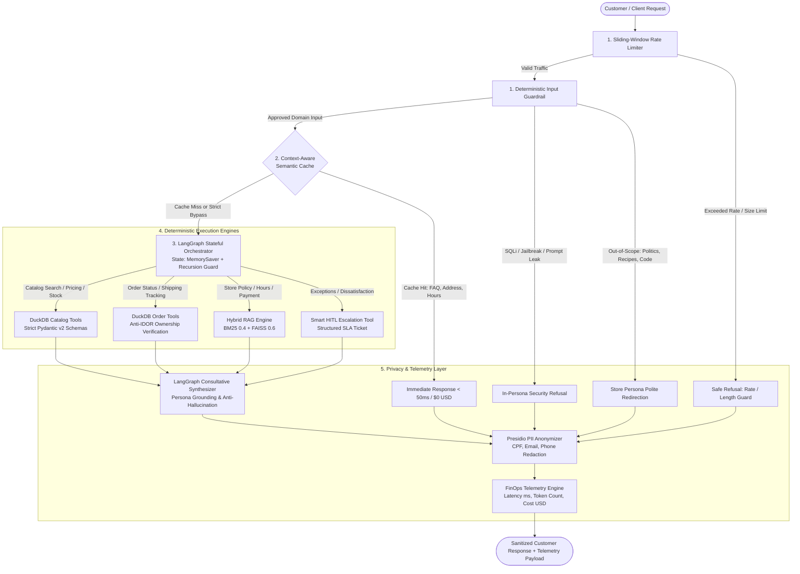

# Empório da Música — Enterprise Intelligent Support Agent

[](https://www.python.org/downloads/)
[](https://langchain-ai.github.io/langgraph/)
[](https://duckdb.org/)
[](https://fastapi.tiangolo.com/)
[](https://streamlit.io/)
[](https://www.docker.com/)
[](https://github.com/astral-sh/ruff)
[](tests/)
[](https://opensource.org/licenses/MIT)

> **Artefact Technical Challenge — AI Engineer**  
> An enterprise-grade, deterministic customer support agent engineered for **Empório da Música** (a musical instruments store in Campo Grande/MS, Brazil). Built under Artefact's core operational principle: *"If not used, it is useless"*, bridging the consultative empathy of Large Language Models (LLMs) with the deterministic reliability of in-memory relational queries, hybrid information retrieval, runtime safety guardrails, and FinOps cost observability.

---

## Table of Contents
1. [Executive Overview & Business Context](#1-executive-overview--business-context)
2. [System Architecture & Layered Execution Flow](#2-system-architecture--layered-execution-flow)
3. [Quickstart, Environment & Model Provider Setup](#3-quickstart-environment--model-provider-setup)
   - [Option A: 1-Command Docker Deployment](#option-a-1-command-docker-deployment)
   - [Option B: Local Setup with `uv` or `pip`](#option-b-local-setup-with-uv-or-pip)
   - [Environment Variables & Switching LLM Providers](#33-environment-variables--switching-llm-providers)
4. [Interaction Interfaces Tour](#4-interaction-interfaces-tour)
   - [Streamlit Observability UI](#41-streamlit-observability-ui)
   - [Rich Interactive CLI](#42-rich-interactive-cli)
   - [FastAPI REST & SSE Streaming Backend](#43-fastapi-rest--sse-streaming-backend)
   - [React / Next.js Vercel AI SDK Integration Snippet](#44-react--nextjs-vercel-ai-sdk-integration-snippet)
5. [In-Depth Technical Justifications & Design Decisions](#5-in-depth-technical-justifications--design-decisions)
   - [Agent Framework: LangGraph vs. Sequential Chains / Free-Form ReAct](#51-agent-framework-langgraph-vs-sequential-chains--free-form-react)
   - [Model & Provider Strategy: Multi-Provider `LLMFactory` & Automatic Failover](#52-model--provider-strategy-multi-provider-llmfactory--automatic-failover)
   - [Data Treatment & Structured Retrieval: DuckDB Typed Tools vs. Raw Text-to-SQL](#53-data-treatment--structured-retrieval-duckdb-typed-tools-vs-raw-text-to-sql)
   - [Unstructured Retrieval Architecture: Hybrid RAG (BM25 + FAISS)](#54-unstructured-retrieval-architecture-hybrid-rag-bm25--faiss)
   - [Prompt Engineering Strategy, Store Persona & Negative Constraints](#55-prompt-engineering-strategy-store-persona--negative-constraints)
   - [Conversation History Persistence: Thread-Scoped `MemorySaver`](#56-conversation-history-persistence-thread-scoped-memorysaver)
   - [Context-Aware Semantic Cache with Transactional & PII Bypass](#57-context-aware-semantic-cache-with-transactional--pii-bypass)
   - [Defense-in-Depth, Anti-IDOR Order Auth & LGPD PII Masking](#58-defense-in-depth-anti-idor-order-auth--lgpd-pii-masking)
   - [Smart Human-in-the-Loop (HITL) & Documented Engineering Assumptions](#59-smart-human-in-the-loop-hitl--documented-engineering-assumptions)
6. [FinOps & Observability](#6-finops--observability)
7. [AI Coding Assistant Disclosure (Google Antigravity Workflow)](#7-ai-coding-assistant-disclosure-google-antigravity-workflow)
8. [Multi-Turn Interaction Transcripts (`transcripts/`)](#8-multi-turn-interaction-transcripts-transcripts)
9. [Known Limitations & What We Would Do With More Time](#9-known-limitations--what-we-would-do-with-more-time)
10. [Repository Structure](#10-repository-structure)

---

## 1. Executive Overview & Business Context

**Empório da Música** is a physical musical instruments store and regional e-commerce hub founded in 2008 in Campo Grande/MS, Brazil. The store's internal sales and support staff face a high volume of repetitive inbound inquiries across digital channels (primarily WhatsApp), causing operational bottlenecks and delayed response times:

- **Institutional FAQs:** Store address (`Rua 14 de Maio, 3200 — Centro, Campo Grande/MS`), business hours, and payment/installment rules.
- **Transactional Inquiries:** Live inventory, exact pricing, active vs. expired promotional discounts, and order fulfillment status.
- **Policy Queries:** Statutory withdrawal rights (CDC 7 days), store defect exchanges (30 days), manufacturer warranties, delivery deadlines, and Campo Grande free-shipping thresholds (`> R$ 500.00`).
- **Store-Specific Boundaries:** The store sells **strictly complete musical instruments** and explicitly does **not** sell loose accessories (strings, picks, cables, pedals, amplifiers, tuners, or cases).

### Business Objective & Core Engineering Principles
The objective is to deploy an autonomous, consultative AI customer support agent that handles tier-1 and tier-2 interactions in **Brazilian Portuguese** (matching the store's clientele) with high conversational empathy, while strictly preventing hallucinations and unauthorized data exposure:

1. **100% Transactional Ground Truth:** Product prices, inventory counts, promotions, and order fulfillment data are never generated probabilistically by the LLM. They are resolved via parameterized **DuckDB** SQL queries over all 6 operational CSV tables.
2. **Low-Latency FinOps Efficiency:** Recurring institutional questions are intercepted by an in-memory **Context-Aware Semantic Cache**, returning sub-50ms responses at **$0.00 token cost**.
3. **Data Governance & LGPD Compliance:** Customer PII (Brazilian CPF, phone numbers, and private emails) is kept strictly in ephemeral memory during order verification and masked via **Presidio-compatible PII redaction** before reaching logs or telemetry outputs.
4. **Resilient Provider Agnosticism:** Inference and embeddings are decoupled via the **`LLMFactory` pattern**, supporting Google Gemini, OpenAI, and local open-weights models via Ollama with automated failover.

---

## 2. System Architecture & Layered Execution Flow

The system is designed as a **5-layer defense-in-depth architecture**:



---

## 3. Quickstart, Environment & Model Provider Setup

### Prerequisites
- **Python 3.11+** installed locally (or **Docker & Docker Compose**).
- One configured LLM provider in `.env`:
  - **Google Gemini** (`GEMINI_API_KEY` from Google AI Studio — default, free tier available), **or**
  - **OpenAI** (`OPENAI_API_KEY` from OpenAI Platform), **or**
  - **Ollama** (100% local & free open-weights execution with zero external API keys).

---

### Option A: 1-Command Docker Deployment

The full stack (FastAPI enterprise backend + Streamlit observability UI) is containerized via `Dockerfile` and `docker-compose.yml`:

```bash
# 1. Clone the repository
git clone https://github.com/willarakaki/desafio-tecnico-ai-eng-artefact.git
cd desafio-tecnico-ai-eng-artefact

# 2. Create .env from template and configure your API key
cp .env.example .env          # On Windows PowerShell: Copy-Item .env.example .env
# Edit .env and set GEMINI_API_KEY (or OPENAI_API_KEY / LLM_PROVIDER=ollama)

# 3. Build and start both services with healthchecks
docker compose up --build
```

- **Streamlit Web UI:** `http://localhost:8501`
- **FastAPI Interactive Swagger UI:** `http://localhost:8000/docs`
- **System Readiness Probe:** `http://localhost:8000/api/health`

---

### Option B: Local Setup with `uv` or `pip`

#### 1. Environment Installation
```bash
# Clone and enter the repository
git clone https://github.com/willarakaki/desafio-tecnico-ai-eng-artefact.git
cd desafio-tecnico-ai-eng-artefact

# Copy environment template
cp .env.example .env          # On Windows PowerShell: Copy-Item .env.example .env
# Fill in your API key in .env

# Option 1: Using uv (Recommended — fast deterministic lockfile resolution)
uv venv --python 3.11
source .venv/bin/activate     # On Windows PowerShell: .\.venv\Scripts\Activate.ps1
uv sync

# Option 2: Using standard pip
python -m venv .venv
source .venv/bin/activate     # On Windows PowerShell: .\.venv\Scripts\Activate.ps1
pip install -r requirements.txt
```

#### 2. Running the Interfaces, Transcripts & Test Suite
```bash
# A. Launch the Streamlit Observability Web UI (http://localhost:8501)
uv run streamlit run app.py

# B. Launch the Rich Interactive Terminal CLI
uv run python cli.py

# C. Launch the FastAPI REST & SSE Streaming Server (http://localhost:8000/docs)
uv run uvicorn src.api.server:app --host 0.0.0.0 --port 8000 --reload

# D. Run the Full Automated Test Suite (170 deterministic unit & integration tests)
uv run pytest -v

# E. Run Linter & Code Formatter Checks
uv run ruff check .
uv run ruff format --check .

# F. Regenerate the 5 Multi-Turn Conversation Transcripts in transcripts/
uv run python scripts/generate_transcripts.py
```

---

### 3.3. Environment Variables & Switching LLM Providers

All runtime parameters are validated through `pydantic-settings` in `src/config.py` (see `.env.example` for the complete template):

| Variable | Default Value | Description |
| :--- | :--- | :--- |
| `LLM_PROVIDER` | `gemini` | Active primary provider: `gemini` \| `openai` \| `ollama`. |
| `GEMINI_API_KEY` | — | Google AI Studio API key (required when `LLM_PROVIDER=gemini`). |
| `GEMINI_ROUTER_MODEL` | `gemini-3.5-flash-lite` | Fast deterministic Gemini model (`temperature=0.0`); also supports `gemini-2.5-flash`. |
| `GEMINI_SYNTHESIZER_MODEL` | `gemini-3.5-flash-lite` | Consultative Gemini model (`temperature=0.2`) for customer responses. |
| `GEMINI_EMBEDDING_MODEL` | `models/gemini-embedding-001` | Dense embedding model for FAISS and Semantic Cache. |
| `OPENAI_API_KEY` | — | OpenAI API key (required for primary `openai` or automatic Gemini $\rightarrow$ OpenAI fallback). |
| `OPENAI_ROUTER_MODEL` | `gpt-4o-mini` | OpenAI routing/synthesis model (`OPENAI_EMBEDDING_MODEL=text-embedding-3-small`). |
| `OLLAMA_BASE_URL` | `http://localhost:11434` | Local Ollama endpoint for zero-cost offline inference (`qwen2.5:7b` + `nomic-embed-text`). |
| `SEMANTIC_CACHE_THRESHOLD` | `0.92` | Cosine similarity threshold (`0.0..1.0`) required for a Semantic Cache `HIT`. |
| `RATE_LIMIT_MAX_REQUESTS` | `15` | Max requests per `session_id` within `RATE_LIMIT_WINDOW_SECONDS` (`60`s). |
| `MAX_INPUT_CHARS` | `2000` | Maximum allowed payload size per user message (`1500` on public REST schema). |

> **Running 100% Locally with Ollama (Free / No API Key):**  
> Install [Ollama](https://ollama.com/), pull the models (`ollama pull qwen2.5:7b && ollama pull nomic-embed-text`), and set `LLM_PROVIDER=ollama` in `.env`.

---

## 4. Interaction Interfaces Tour

The agent exposes three native interaction interfaces catering to customers, support supervisors, and frontend engineers:

### 4.1. Streamlit Observability UI (`app.py`)
- **Customer Chat Panel:** Conversational interface embodying the consultative *Empório da Música* musical specialist persona.
- **FinOps & Observability Sidebar:**
  - Real-time turn latency (milliseconds) and active provider/model badge (including fallback alerts).
  - Live Semantic Cache status (`HIT`, `MISS`, or `BYPASS_TRANSACTIONAL`).
  - Deterministic tools executed during the turn.
  - Cumulative session token consumption and estimated inference spend in USD.
  - **Human-in-the-Loop Alert Card:** Visual handoff ticket card displaying `ticket_id`, urgency level, summary, and `24 horas úteis` SLA whenever human escalation occurs.

### 4.2. Rich Interactive CLI (`cli.py`)
Designed for rapid terminal evaluation and developer inspection:
- Styled terminal chat panels with per-turn tool call traces, cache status, and latency metadata.
- Built-in slash commands:
  - `/metrics` — Renders a FinOps summary table with session token counts, USD spend, and cache hit distribution.
  - `/clear` — Resets conversation thread memory and clears the session's rate-limit window.
  - `/exit` — Gracefully exits the CLI.

### 4.3. FastAPI REST & SSE Streaming Backend (`src/api/server.py`)

| Method | Endpoint | Description |
| :--- | :--- | :--- |
| `POST` | `/api/chat` | Synchronous turn execution returning sanitized text, FinOps telemetry, tools called, and HITL tickets. |
| `POST` | `/api/chat/stream` | Server-Sent Events (SSE) streaming endpoint yielding incremental step, tool, and token events. |
| `GET` | `/api/health` | Production readiness/liveness probe auditing DuckDB tables, Hybrid RAG index, LLM config, and Cache. |
| `GET` | `/api/metrics` | Returns aggregated FinOps metrics globally or filtered by `?session_id=...`. |
| `GET` | `/docs` | Interactive OpenAPI Swagger UI (`/redoc` also available). |

### 4.4. React / Next.js Vercel AI SDK Integration Snippet

`/api/chat/stream` natively supports the **Vercel AI SDK Data Stream protocol** (`format="vercel"` or header `x-vercel-ai-data-stream: v1`):

```tsx
// app/components/EmporioChat.tsx (Next.js App Router / React)
"use client";

import { useChat } from "@ai-sdk/react";

export default function EmporioChat() {
  const { messages, input, handleInputChange, handleSubmit, isLoading } = useChat({
    api: "http://localhost:8000/api/chat/stream",
    experimental_prepareRequestBody: ({ messages }) => ({
      query: messages.at(-1)?.content ?? "",
      session_id: "customer-session-123",
      format: "vercel",
    }),
  });

  return (
    <div className="flex flex-col h-screen max-w-2xl mx-auto p-4">
      <header className="border-b pb-2 mb-4 font-bold text-xl text-amber-700">
        Empório da Música — Atendimento Especializado
      </header>
      <div className="flex-1 overflow-y-auto space-y-4">
        {messages.map((m) => (
          <div key={m.id} className="p-3 rounded-lg bg-gray-100">
            <strong>{m.role === "user" ? "Você: " : "Especialista: "}</strong>
            {m.content}
          </div>
        ))}
      </div>
      <form onSubmit={handleSubmit} className="flex gap-2 mt-4">
        <input
          value={input}
          onChange={handleInputChange}
          placeholder="Pergunte sobre violões, preços, prazos de troca ou seu pedido..."
          className="flex-1 border p-2 rounded"
          disabled={isLoading}
        />
        <button type="submit" disabled={isLoading} className="bg-amber-600 text-white px-4 py-2 rounded">
          Enviar
        </button>
      </form>
    </div>
  );
}
```

---

## 5. In-Depth Technical Justifications & Design Decisions

Every architectural choice required by the challenge specification was evaluated against production reliability, accuracy, latency, and security trade-offs:

### 5.1. Agent Framework: LangGraph vs. Sequential Chains / Free-Form ReAct
- **Why not Linear Chains or Pure RAG?** Customer conversations frequently require **multi-source tool composition** in a single turn (e.g., querying order `#4` in DuckDB *and* checking the 30-day defect exchange policy in the PDF *and* opening a HITL escalation ticket). Static RAG pipelines cannot orchestrate conditional relational + unstructured lookups.
- **Why LangGraph over Unconstrained Agents?** `src/agent/graph.py` models the assistant as an explicit state machine (`StateGraph`) with:
  - Bounded cyclic tool execution (`recursion_limit = 6`) that prevents runaway loops and gracefully falls back to a human handoff ticket if exceeded.
  - **Anti-Phantom HITL Guard:** A post-synthesis verification hook inspects the assistant's final text; if the LLM ever promises *"vou transferir para um especialista humano"* without having invoked `escalate_to_human`, the graph deterministically creates a real `TKT-...` escalation record so no customer request is silently dropped.

---

### 5.2. Model & Provider Strategy: Multi-Provider `LLMFactory` & Automatic Failover
- **Why Decouple Providers?** Direct SDK calls scatter vendor-specific parameters across the codebase. `src/agent/llm_factory.py` centralizes instantiation across **Google Gemini** (low-cost, fast tool calling, generous free tier for evaluation), **OpenAI** (`gpt-4o-mini`), and **Ollama** (`qwen2.5:7b` for air-gapped local runs).
- **Cost/Quality Profile Separation:**
  - `get_router_llm(temperature=0.0)` ensures deterministic tool argument generation and intent routing.
  - `get_synthesizer_llm(temperature=0.2)` enables warm, consultative Brazilian Portuguese responses without creative drift.
- **Automatic Provider Failover:** Using LangChain `.with_fallbacks()`, transient HTTP `429`/`500`/timeout failures on the primary provider automatically fail over to configured secondary providers (recording `fallback_used=True` in telemetry), and degrade gracefully to a HITL ticket if all providers are unreachable.

---

### 5.3. Data Treatment & Structured Retrieval: DuckDB Typed Tools vs. Raw Text-to-SQL
- **Why Not Raw CSV-in-Prompt or Free-Form Text-to-SQL?** Injecting all 6 CSVs into every prompt wastes tokens and degrades numeric filtering accuracy, while LLM-generated SQL exposes the system to SQL injection and dialect hallucinations.
- **In-Memory DuckDB + Data Profiling Ground Truth (`src/database/duckdb_manager.py`):** All 6 UTF-8 CSV files (`categories` [9], `products` [65], `promotions` [25], `customers` [50], `orders` [20], `order_items` [22]) are ingested at startup with clean table names and a custom accent-stripping SQL macro (`strip_accents`) plus whitespace trimming.
- **Real Dataset Nuances Handled Deterministically:**
  1. **Status vs. Stock Contradictions:** Profiling revealed `product_id=96` (*Giannini GF-3D*) has `status='active'` with `stock_quantity=0`, while `product_id=136` (*Ibanez Bass 2X*) has `status='discontinued'` despite `stock_quantity=13`, and `product_id=130` is `'coming_soon'` (`stock=2`). Therefore, `search_products(..., in_stock_only=True)` strictly enforces `status = 'active' AND stock_quantity > 0`.
  2. **Expired Promotions Trap:** Only **4 of 25** rows in `promotions.csv` have `is_active = 1` (`product_id` `90`, `94`, `121`, `127`). The other 21 rows—including *Takamine GD20* (`product_id=95`, `12%`, `is_active=0`)—are expired. `get_active_promotions` filters `is_active = 1`, and `get_product_details` explicitly flags expired promotions so the agent never grants inactive discounts.
  3. **Empty Categories & Synthetic Attribute Variance:** Categories `6`, `7`, and `8` (woodwinds, brass, orchestral strings) contain `0` rows in `products.csv`, and rows `135..144` exhibit minor brand/spec differences across `name`, `description`, and JSON `specs`. Tools normalize searches across both `name` and `description` and return verbatim records with clear fallback guidance when a category has zero stock.
  4. **Strict Pydantic v2 Tool Schemas:** The LLM interacts solely through 4 typed tools (`search_products`, `get_product_details`, `get_active_promotions`, `get_order_status`) backed by `100%` parameterized SQL bindings.

---

### 5.4. Unstructured Retrieval Architecture: Hybrid RAG (BM25 + FAISS)
- **Why Hybrid Retrieval?** `data/políticas_da_loja.pdf` (8 pages, *Manual de Políticas e Procedimentos v2.1*) blends conceptual policies (exchange eligibility, warranty exclusions) with exact lexical tokens (`CEP 79202-333`, CNPJ `12.345.678/0001-90`, `09:00 às 18:00`, `7 dias corridos`, `30 dias`, `90 dias`, `5%` PIX discount, `12x` installment minimums `R$ 80` / `R$ 100`, WhatsApp `(67) 3321-4500`). Pure dense embeddings often lose exact numeric/code recall, while pure keyword search misses colloquial phrasing.
- **Cross-Page Section Chunking (`src/rag/pdf_loader.py`):** Sections `5.2` (shipping tables), `7.2` (WhatsApp conduct), and `9` (LGPD) span page breaks. Pages are concatenated with page-span metadata before splitting on numbered section headers so tables and rules never detach from their heading context.
- **Weighted Ensemble (`src/rag/hybrid_retriever.py`):** Combines a custom Portuguese accent-folded **BM25 retriever (weight `0.4`)**—preserving compound tokens like `79202-333`, `09:00`, `5%`, `12x`—with **FAISS dense semantic search (weight `0.6`)**, exposed via `consult_store_policies(question)`.

---

### 5.5. Prompt Engineering Strategy, Store Persona & Negative Constraints
Defined in `src/agent/prompts.py`, our prompt architecture follows four deliberate design principles:
1. **Authentic Musical Specialist Persona:** Warm, consultative tone in Brazilian Portuguese aligned with Section 7 of `políticas_da_loja.pdf`—capable of advising beginners and experienced musicians on tonewoods (spruce, cedar, mahogany, sapele, rosewood), nylon vs. steel strings, and instrument playability.
2. **Intentional Context Slimming (Forcing Tool Grounding):** Core institutional identity is anchored in the prompt, whereas detailed normative rules (warranty exclusions, return deadlines, carrier SLAs, installment minimums) are **deliberately omitted** from the System Prompt with an explicit instruction requiring `consult_store_policies` invocation. This eliminates "memory-based" policy hallucinations.
3. **Parallel Multi-Tool Composition:** Explicit directives instruct the model to invoke multiple tools in parallel within the same turn whenever a customer combines catalog/order questions with policy or HITL requests.
4. **8 Strict Negative Constraints:**
   - Never invent prices, stock counts, tracking codes, or policy deadlines without tool execution.
   - Enforce **non-cumulative promotions** (the 5% upfront PIX discount never stacks onto an active promotional price).
   - Never apply expired promotions (`is_active = 0`).
   - Politely decline loose accessory sales (strings, picks, cables, pedals, amps, cases) as outside store scope.
   - Never claim human transfer without calling `escalate_to_human`.
   - Distinguish informative policy questions (answer via RAG) from formal exception demands/complaints (escalate via HITL).
   - Enforce mandatory order ownership verification before disclosing order details.
   - Politely refuse off-topic subjects (recipes, politics, general programming) while remaining in persona.

---

### 5.6. Conversation History Persistence: Thread-Scoped `MemorySaver`
- **Decision & Justification:** Customer service naturally unfolds across multiple turns (e.g., Turn 1: *"Quais violões até R$ 1.000?"* $\rightarrow$ Turn 2: *"Qual a diferença entre o Yamaha e o Strinberg?"* $\rightarrow$ Turn 3: *"Tem desconto no PIX?"*). Without state persistence, customers must repeat product names and credentials on every message.
- **Implementation:** LangGraph's `MemorySaver` checkpointer persists message history keyed by `session_id` (`thread_id`) across Streamlit sessions, CLI runs, and FastAPI `/api/chat` + `/api/chat/stream` calls, with instant state reset via `/clear` or the UI reset button.

---

### 5.7. Context-Aware Semantic Cache with Transactional & PII Bypass
- **Efficiency Without Data Leakage (`src/cache/semantic_cache.py`):** Validated `(query_embedding, response)` pairs for institutional FAQs are cached in memory (`cosine similarity >= 0.92`), resolving recurrent questions on store hours and address in **< 50ms at $0.00 cost**.
- **Strict Bypass Rule (`BYPASS_TRANSACTIONAL`):** Any message containing order numbers, tracking codes (`BR...BR`), CPF, email, phone numbers, conversational follow-up pronouns, or live stock/price lookup intents bypasses both cache reads and writes—preventing stale stock answers and cross-customer PII leaks.

---

### 5.8. Defense-in-Depth, Anti-IDOR Order Auth & LGPD PII Masking
- **Sliding-Window Rate Limiter (`src/security/rate_limiter.py`):** Per-session request throttling and maximum character bounds protect against abuse and Denial-of-Wallet spikes.
- **Deterministic Input Guardrails (`src/security/guardrails.py`):** Intercepts SQL injection payloads, DAN/system-override jailbreaks, prompt-extraction attempts, and off-domain topics *before* spending LLM tokens.
- **Anti-IDOR Order Authentication (`src/tools/order_tools.py`):** Querying an order by `order_id` alone (e.g., *"Qual o status do pedido #5?"*) is blocked; the customer must supply a matching `customer_identifier` (email, digits-normalized phone, or registered full name) verified against the order's owner in DuckDB.
- **Presidio-Compatible PII Anonymizer (`src/security/pii_anonymizer.py`):** Masks Brazilian `CPF`, personal `EMAIL_ADDRESS`, and `PHONE_NUMBER` entities in telemetry and logs while whitelisting official Empório da Música institutional contacts (`(67) 3341-4444`, `(67) 3321-4500`, `contato@emporiodamusica.com.br`).

---

### 5.9. Smart Human-in-the-Loop (HITL) & Documented Engineering Assumptions
- **HITL Escalation (`src/tools/hitl_tools.py`):** Invoking `escalate_to_human(reason, case_summary, urgency_level)` generates an auditable `TKT-YYYYMMDD-XXXXXX` protocol with urgency triage and the policy manual's `24 horas úteis` SLA.
- **Documented Engineering & Domain Assumptions:**
  1. **Language Convention:** All codebase modules, schemas, tests, and technical documentation are written in **English** (per submission instructions), while the customer-facing persona, domain filter terms (`"violão"`, `"Campo Grande"`), and dataset filenames (`data/políticas_da_loja.pdf`) remain in **Brazilian Portuguese**.
  2. **Customer Verification Without CPF Column:** Profiling revealed `customers.csv` contains `customer_id`, `name`, `phone`, `email`, and `city` (no `cpf` column, and `bruno.martins@jmail.com` is shared across `customer_id=11` and `43`). We assumed email, phone, or full name as the primary ownership verifier for `get_order_status`, while still enforcing CPF detection/masking in `pii_anonymizer.py` and `semantic_cache.py` in case customers volunteer their CPF in chat.
  3. **Full Dataset Utilization:** Although optional in the prompt, we integrated **all 6 CSV tables** and **all 10 sections of the PDF manual** to deliver complete catalog, promotion, customer, order-item, and policy coverage.

---

## 6. FinOps & Observability

Every customer turn records a structured `TurnTelemetry` object (`src/observability/telemetry.py`):

```json
{
  "turn_latency_ms": 3.4,
  "cache_status": "HIT",
  "tools_called": [],
  "prompt_tokens": 0,
  "completion_tokens": 0,
  "total_tokens": 0,
  "estimated_cost_usd": 0.0,
  "active_provider": "gemini",
  "active_model": "gemini-2.5-flash",
  "fallback_used": false,
  "requires_human_intervention": false
}
```

### Simulated Cost Savings Analysis (10,000 Turns/Month)

| Interaction Profile | Volume Share | Cost w/o Cache (USD) | Cost with Empório Cache (USD) | FinOps Savings | Average Latency |
| :--- | :---: | :---: | :---: | :---: | :---: |
| **Institutional FAQ** (Hours, Address) | 45% | $3.15 | **$0.00** | **100%** | **< 50 ms** |
| **Policy Inquiries** (Warranty, Shipping) | 25% | $2.62 | $1.05 *(warm cache)* | **60%** | **~450 ms** |
| **Live Catalog & Pricing** (DuckDB) | 20% | $2.80 | $2.80 *(strict bypass)* | 0% *(accuracy)* | **~850 ms** |
| **Order Status & HITL** (Sensitive) | 10% | $1.75 | $1.75 *(strict bypass)* | 0% *(LGPD)* | **~1,100 ms** |
| **Total / Net Operational Spend** | **100%** | **$10.32** | **$5.60** | **45.7% Net Savings** | **Sub-500ms Weighted** |

### LangSmith Distributed Tracing Integration
Zero-code distributed tracing is built into `src/config.py`. Set the following variables in `.env` to inspect full LangGraph run trees, tool latencies, and token waterfalls in **LangSmith**:

```env
LANGCHAIN_TRACING_V2=true
LANGCHAIN_API_KEY="your-langsmith-api-key"
LANGCHAIN_PROJECT="emporio-da-musica-agent"
```

---

## 7. AI Coding Assistant Disclosure (Google Antigravity Workflow)

In full transparency with Artefact's evaluation guidelines, **Google Antigravity** (Agentic AI IDE) was used as an engineering pair-programmer throughout development under strict human architectural governance.

### How the Tool Was Used: Spec-Driven Development (SDD) + Strict TDD
Rather than relying on unconstrained prompt-to-code generation, we engineered an auditable, human-gated workflow governed by workspace rules (`AGENTS.md`), upfront architecture specifications (`docs/architecture.md`), atomic milestones (`TASKS.md`), and a custom agent skill (`.agents/skills/tdd-commit-gate/SKILL.md`):

```
[1. Raw Dataset & PDF Profiling] (Human + Agent inspect CSV edge cases & PDF sections)
                │
                ▼
[2. Upfront Architecture Specification] (docs/architecture.md & AGENTS.md rules)
                │
                ▼
[3. Atomic Milestone Breakdown] (TASKS.md: Tasks 0 through 9)
                │
                ▼
[4. Isolated Task Branch] (chore/*, feat/*, docs/* via tdd-commit-gate skill)
                │
                ▼
[5. Test-Driven Implementation] (170 Pytest unit/integration tests + Ruff lint/format)
                │
                ▼
[6. Human Code Review & GitHub Actions CI] (Pull Request -> CI Green -> Merge to main)
```

### Key Benefits of This Workflow
1. **Data-First Grounding Before Writing Code:** Profiling `data/*.csv` and `data/políticas_da_loja.pdf` upfront uncovered subtle traps (such as `Takamine GD20`'s expired promotion `is_active=0`, `Giannini GF-3D` having `status='active'` with `0` stock, and cross-page PDF tables) before a single tool was coded.
2. **Custom `tdd-commit-gate` Skill Enforcement:** Prevented untested code, hardcoded credentials, raw SQL string interpolation, or direct LLM SDK instantiations outside `LLMFactory` from ever being committed.
3. **Clean, Progressive Git History:** Every task was delivered as an atomic branch and reviewed via GitHub Pull Requests with automated CI (`ruff` + `pytest`), maintaining full engineering traceability.

---

## 8. Multi-Turn Interaction Transcripts (`transcripts/`)

Five multi-turn conversations were executed through the agent pipeline (`scripts/generate_transcripts.py`) and saved in `transcripts/` complete with tool traces, HITL payloads, and FinOps telemetry:

1. **[`transcripts/01_catalogo_violoes_ate_1000.md`](transcripts/01_catalogo_violoes_ate_1000.md)** — *Catalog Search & Musical Consultation:*  
   Filters available acoustic guitars up to R$ 1,000 (`search_products`), compares top woods between *Yamaha C40M II* and *Strinberg SD200C* (`get_product_details`), recommends nylon strings for beginners, and politely explains that loose picks/strings/cases are not sold.
2. **[`transcripts/02_preco_especifico_takamine_gd20.md`](transcripts/02_preco_especifico_takamine_gd20.md)** — *Exact Price, Expired Promotion & Payment Rules:*  
   Looks up *Takamine GD20* (`get_product_details`), transparently informs the customer that the historical 12% promotion is expired (`is_active=0`), states current stock (4 units at R$ 2,890.00), and retrieves PIX 5% upfront discount and 12x interest-free card rules (`consult_store_policies`).
3. **[`transcripts/03_informacoes_gerais_e_endereco.md`](transcripts/03_informacoes_gerais_e_endereco.md)** — *Store Info, Opening Hours & Semantic Cache `HIT`:*  
   Answers Campo Grande/MS physical address and business hours via RAG on Turn 1 (`MISS`), serves a paraphrased follow-up via **Semantic Cache `HIT` in `3.4 ms` at `$0.000000 USD`** on Turn 2, and explains local courier shipping (`> R$ 500` free) on Turn 3.
4. **[`transcripts/04_politica_devolucao_pedido_e_hitl.md`](transcripts/04_politica_devolucao_pedido_e_hitl.md)** — *Non-Trivial Multi-Source Scenario (Order CSV + Policy PDF + HITL):*  
   Verifies ownership and status for `Order #4` (*Lucas Mendes*, `BYPASS_TRANSACTIONAL`), consults the PDF manual on the 30-day store defect exchange vs. 90-day CDC warranty, and triggers `escalate_to_human` when an urgent weekend exception is requested—emitting a structured `TKT-...` handoff ticket with PII redaction.
5. **[`transcripts/05_guardrails_fora_de_escopo_e_jailbreak.md`](transcripts/05_guardrails_fora_de_escopo_e_jailbreak.md)** — *Out-of-Scope Refusal, Jailbreak Defense & Recovery:*  
   Politely declines a culinary recipe request in-persona, blocks a `SYSTEM OVERRIDE` prompt-extraction jailbreak in `3.5 ms` at zero LLM token cost, and smoothly resumes consultative ukulele recommendations when the user returns to scope.

---

## 9. Known Limitations & What We Would Do With More Time

### 9.1. Current Known Limitations & Technical Root Causes

| Current Limitation | Technical Root Cause | Impact on Current Prototype |
| :--- | :--- | :--- |
| **In-Memory Semantic Cache** | Single-process Python memory store; resets on container restart and has no cross-worker sharing. | Ideal for single-container zero-friction evaluation, but cache warms up again after restarts. |
| **In-Memory Session Checkpointer** | LangGraph `MemorySaver` stores conversation threads in RAM without TTL eviction. | Multi-turn context works seamlessly per process, but horizontal multi-replica scaling requires external state. |
| **Read-Only CSV Snapshot** | DuckDB ingests `data/*.csv` into memory at startup without live ERP write-back or CDC sync. | Reflects challenge dataset ground truth accurately, but does not mutate stock or create live orders. |
| **Simulated Messaging Channel** | Customer interactions occur via Streamlit, CLI, and FastAPI REST/SSE rather than a live Meta webhook. | Production-ready HTTP/SSE contract is in place, awaiting WhatsApp Business Cloud API credentials. |
| **Heuristic Pre-LLM Guardrail** | Pre-inference guardrail uses curated regex signatures for SQLi/jailbreaks and domain keywords. | Fast (`<5ms`) and zero-cost, though novel obfuscated adversarial prompts benefit from a neural classifier. |
| **Cold-Start FAISS Indexing** | Policy PDF chunks (`políticas_da_loja.pdf`) are embedded on initial retriever initialization. | Adds ~1–2s on the very first uncached policy lookup; negligible once initialized in singleton memory. |

---

### 9.2. What We Would Do With More Time (Production Roadmap)

Given additional engineering sprints to take Empório da Música into live production, we would prioritize five concrete upgrades:

1. **Distributed Redis Semantic Cache & PostgreSQL Checkpointing:**
   - Migrate `SemanticCache` to **Redis Stack (RediSearch Vector)** with TTL expiration and webhook-driven invalidation whenever product prices or promotions change.
   - Replace `MemorySaver` with **`AsyncPostgresSaver`** so multi-turn WhatsApp/Web sessions persist across container restarts and horizontally scaled FastAPI replicas.
2. **Official WhatsApp Business Cloud API + MCP Server Architecture:**
   - Connect FastAPI webhooks directly to the **Meta WhatsApp Cloud API** (supporting voice-note transcription for audio inquiries and human agent takeover inside the store's CRM).
   - Expose DuckDB catalog/order tools and carrier tracking integrations as standardized **Model Context Protocol (MCP)** servers.
3. **Dedicated Neural Safety Classifier (Llama Prompt Guard 2):**
   - Add a self-hosted **Llama Prompt Guard 2 (86M)** sidecar via **vLLM** / ONNX Runtime to detect multilingual indirect prompt injections and obfuscated jailbreaks in `<10ms` without external token spend.
4. **Automated LLM Evaluation Gate in CI/CD (Ragas & DeepEval):**
   - Extend GitHub Actions CI with an evaluation dataset of 200+ golden Brazilian Portuguese customer dialogues measuring **Faithfulness**, **Context Precision**, **Tool Selection Accuracy**, and **Answer Relevancy** on every prompt or retriever change.
5. **Live Transactional ERP Integration & Proactive Notifications:**
   - Connect `order_tools` to the store's live ERP/POS system and Correios/Jadlog tracking webhooks to proactively notify customers of shipping milestones.

---

## 10. Repository Structure

```text
emporio-da-musica-agent/
├── .agents/
│   └── skills/
│       └── tdd-commit-gate/SKILL.md  # Custom agentic TDD quality gate skill
├── .github/
│   └── workflows/ci.yml              # GitHub Actions CI (Ruff + Pytest across 170 tests)
├── data/
│   ├── desafio_tecnico_ai_eng - categories.csv
│   ├── desafio_tecnico_ai_eng - customers.csv
│   ├── desafio_tecnico_ai_eng - order_items.csv
│   ├── desafio_tecnico_ai_eng - orders.csv
│   ├── desafio_tecnico_ai_eng - products.csv
│   ├── desafio_tecnico_ai_eng - promotions.csv
│   └── políticas_da_loja.pdf         # Internal store policy & procedure manual (8 pages)
├── docs/
│   └── architecture.md               # Detailed system architecture & mapped data dictionary
├── scripts/
│   └── generate_transcripts.py       # Automated generator for the 5 multi-turn scenarios
├── src/
│   ├── agent/
│   │   ├── graph.py                  # LangGraph stateful orchestrator & anti-phantom guard
│   │   ├── llm_factory.py            # Multi-provider LLM/Embedding factory + fallbacks
│   │   ├── prompts.py                # Empório specialist System Prompt & negative rules
│   │   └── state.py                  # Typed LangGraph state definitions
│   ├── api/
│   │   ├── __init__.py
│   │   └── server.py                 # FastAPI REST, SSE & Vercel AI SDK streaming server
│   ├── cache/
│   │   └── semantic_cache.py         # Context-aware cosine cache with transactional bypass
│   ├── database/
│   │   └── duckdb_manager.py         # In-memory DuckDB ingestion & accent-folding macros
│   ├── observability/
│   │   └── telemetry.py              # FinOps latency, token, and USD cost tracker
│   ├── rag/
│   │   ├── hybrid_retriever.py       # Weighted BM25 (0.4) + FAISS (0.6) policy retriever
│   │   └── pdf_loader.py             # Cross-page section-aware PDF policy loader
│   ├── security/
│   │   ├── guardrails.py             # Deterministic SQLi, Jailbreak & Scope guardrails
│   │   ├── pii_anonymizer.py         # Presidio-compatible LGPD PII redaction
│   │   └── rate_limiter.py           # Sliding-window session rate & payload limiter
│   ├── tools/
│   │   ├── catalog_tools.py          # Typed Pydantic v2 DuckDB catalog & promotion tools
│   │   ├── hitl_tools.py             # Smart Human-in-the-Loop ticket escalation tool
│   │   ├── order_tools.py            # Anti-IDOR order lookup & verification tool
│   │   └── policy_tools.py           # Hybrid RAG store policy consultation tool
│   └── config.py                     # Centralized pydantic-settings configuration
├── tests/                            # 170 unit & integration tests (100% pass rate)
│   ├── conftest.py
│   ├── test_agent_routing.py
│   ├── test_api.py
│   ├── test_duckdb_tools.py
│   ├── test_interfaces.py
│   ├── test_llm_factory.py
│   ├── test_rag_policies.py
│   ├── test_security_and_cache.py
│   └── test_setup_and_data.py
├── transcripts/                      # 5 multi-turn conversation traces with FinOps metrics
│   ├── 01_catalogo_violoes_ate_1000.md
│   ├── 02_preco_especifico_takamine_gd20.md
│   ├── 03_informacoes_gerais_e_endereco.md
│   ├── 04_politica_devolucao_pedido_e_hitl.md
│   └── 05_guardrails_fora_de_escopo_e_jailbreak.md
├── .env.example                      # Environment configuration template
├── app.py                            # Streamlit UI with live FinOps & HITL sidebar
├── cli.py                            # Rich interactive terminal interface
├── docker-compose.yml                # Multi-service Docker Compose (FastAPI + Streamlit)
├── Dockerfile                        # Lightweight Python 3.11 + uv container image
├── pyproject.toml                    # Project metadata, Ruff & Pytest configuration
├── requirements.txt                  # Standard pip dependency manifest
└── README.md                         # Executive & technical project documentation
```

---

## License

This project is released under the **MIT License**. Developed for the **Artefact Brazil — AI Engineer Technical Challenge**.
