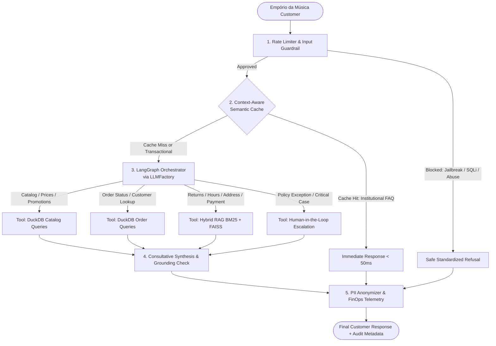
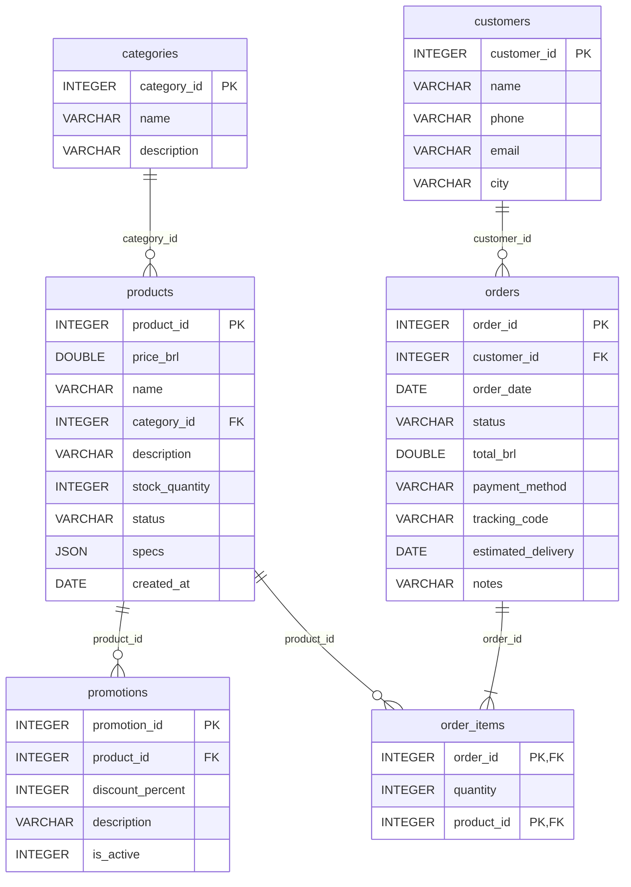

# System Architecture — Empório da Música Intelligent Assistant

## 1. Executive Overview & Engineering Assumptions
This system is engineered under Artefact's core operational principle (*"If not used, it is useless"*): bridging the conversational empathy of Large Language Models (LLMs) with the deterministic reliability of in-memory relational queries, hybrid information retrieval, and runtime safety guardrails.

### Core Engineering Assumptions
- **Latency & FinOps Efficiency:** Recurrent institutional questions (opening hours, store address, general return rules) must be served in under 50ms at zero token cost after the initial lookup via a **Context-Aware Semantic Cache**.
- **Transactional Accuracy:** Product pricing, stock availability, promotions, and order status lookups require 100% deterministic accuracy, handled via parameterized **DuckDB** SQL queries over the operational CSV files.
- **Data Governance & Privacy (LGPD):** Customer Personally Identifiable Information (PII — Brazilian CPF, email, phone number) is kept strictly in ephemeral memory during DuckDB tool execution and automatically redacted via **Presidio-compatible PII Masking** before reaching logs or telemetry panels.
- **Provider Agnosticism:** The inference layer is decoupled through the **`LLMFactory` pattern**, supporting Google Gemini (`gemini-2.5-flash`), OpenAI (`gpt-4o-mini`), or local open-weights models via Ollama (`qwen2.5`).

---

## 2. System Topology & Layered Execution Flow

### 2.1. Mapped Data Dictionary

#### 2.1.1. Relational Schema & DuckDB Table Mapping (`data/*.csv`)

All 6 operational CSV files are UTF-8 (NFC) encoded, comma-delimited (`","`), and exhibit 100% referential integrity (zero orphan foreign keys). During ingestion (`src/database/duckdb_manager.py`), the `desafio_tecnico_ai_eng - ` filename prefix is stripped to expose clean SQL table names:

| Exact CSV Filename | DuckDB Table | Rows | Primary Key | Columns (`name: TYPE`) & Domain Constraints |
| :--- | :--- | :---: | :--- | :--- |
| `desafio_tecnico_ai_eng - categories.csv` | `categories` | 9 | `category_id` | `category_id: INTEGER` (`1..9`), `name: VARCHAR`, `description: VARCHAR` |
| `desafio_tecnico_ai_eng - products.csv` | `products` | 65 | `product_id` | `product_id: INTEGER` (`81..145`), `price_brl: DOUBLE`, `name: VARCHAR`, `category_id: INTEGER` (FK), `description: VARCHAR`, `stock_quantity: INTEGER` (`0..15`), `status: VARCHAR` (`'active'` \| `'discontinued'` \| `'coming_soon'`), `specs: JSON`, `created_at: DATE` (`YYYY-MM-DD`) |
| `desafio_tecnico_ai_eng - promotions.csv` | `promotions` | 25 | `promotion_id` | `promotion_id: INTEGER` (`1..25`), `product_id: INTEGER` (FK), `discount_percent: INTEGER` (`5..40`), `description: VARCHAR`, `is_active: INTEGER` (`0` \| `1`) |
| `desafio_tecnico_ai_eng - customers.csv` | `customers` | 50 | `customer_id` | `customer_id: INTEGER` (`1..50`), `name: VARCHAR`, `phone: VARCHAR` (`(67) 9XXXX-XXXX`), `email: VARCHAR`, `city: VARCHAR` (`Campo Grande`, `Dourados`, `Três Lagoas`, `Corumbá`, `Ponta Porã`) |
| `desafio_tecnico_ai_eng - orders.csv` | `orders` | 20 | `order_id` | `order_id: INTEGER` (`1..20`), `customer_id: INTEGER` (FK), `order_date: DATE`, `status: VARCHAR` (`'delivered'` \| `'shipped'` \| `'confirmed'` \| `'pending'` \| `'cancelled'`), `total_brl: DOUBLE`, `payment_method: VARCHAR` (`'pix'` \| `'debit'` \| `'boleto'` \| `'credit_3x'` \| `'credit_6x'` \| `'credit_12x'`), `tracking_code: VARCHAR NULL` (`BR[A-Z0-9]{9}BR`), `estimated_delivery: DATE NULL`, `notes: VARCHAR NULL` |
| `desafio_tecnico_ai_eng - order_items.csv` | `order_items` | 22 | `(order_id, product_id)` | Exact column order: `order_id: INTEGER` (FK), `quantity: INTEGER` (`1..2`), `product_id: INTEGER` (FK) |

**Data Profiling Nuances & Engineering Rules (Ground Truth):**
- **JSON `specs` Keys in `products`:** Valid JSON across all 65 rows; keys vary by instrument family (`back_sides`, `body`, `color`, `electronics`, `hardware`, `keys`, `neck`, `pieces`, `polyphony`, `scale`, `shells`, `strings`, `top`, `type`).
- **Empty Categories (`6`, `7`, `8`):** Categories `6` (*Instrumentos de Sopro (Madeiras)*), `7` (*Instrumentos de Sopro (Metais)*), and `8` (*Cordas Orquestrais*) have `0` rows in `products.csv` (active products cover `5=Violões` [35], `9=Ukuleles` [15], `1=Guitarras` [5], `2=Baixos` [4], `3=Baterias e Percussão` [3], `4=Teclados e Pianos` [3]).
- **Availability & Status Edge Cases:** `product_id=96` (*Giannini GF-3D Dreadnought Sunburst*) has `status='active'` with `stock_quantity=0`; `product_id=136` (*Ibanez Bass 2X Electric Bass*) has `status='discontinued'` despite `stock_quantity=13`; `product_id=113` is `discontinued` (`stock=0`); `product_id=130` is `coming_soon` (`stock=2`). Consequently, `in_stock_only=True` queries **must** filter `status = 'active' AND stock_quantity > 0`.
- **Synthetic Attribute Variance (`product_id` `135..144`):** Challenge rows for basses, drums, and keyboards exhibit minor brand/spec differences between `name`, `description`, and `specs`; catalog search normalizes across both `name` and `description` and returns verbatim attributes to prevent hallucination.
- **Active vs. Expired Promotions:** Only **4 of 25** rows in `promotions` have `is_active = 1` (`product_id` `90` [18%], `94` [8%], `121` [20%], `127` [10%]). The remaining 21 rows have `is_active = 0` (expired), including *Takamine GD20* (`product_id=95`, `discount_percent=12`, `is_active=0`).
- **Customer Lookup & LGPD PII Note:** `customers.csv` does **not** contain a `cpf` column (and `bruno.martins@jmail.com` appears on both `customer_id=11` and `customer_id=43`). `get_order_status` supports matching `customer_identifier` against `email`, digits-normalized `phone`, accent-insensitive `name`, or `customer_id`, while `pii_anonymizer.py` and `semantic_cache.py` still enforce CPF, email, and phone detection/masking on user inputs and outputs.
- **Nullable Order Fields:** `tracking_code` and `estimated_delivery` are populated exclusively on `delivered` and `shipped` orders (`order_id` `1..8`); `notes` is populated exclusively on `cancelled` orders (`order_id` `17..20`).

#### 2.1.2. Unstructured Policy Manual (`data/políticas_da_loja.pdf`)

- **Document Metadata:** *Manual de Políticas e Procedimentos — Atendimento ao Cliente*, Versão 2.1 (Junho de 2025), 8 pages, NFC filename `políticas_da_loja.pdf`.
- **Section Hierarchy & Operational Rules:**
  - **Cover (Page 1) & `1. Sobre a Empório da Música` (`1.1 Missão`, `1.2 Dados da Empresa` — Page 2):** Founded 2008 in Campo Grande/MS; Razão Social `Empório da Música Instrumentos Musicais Ltda.`; CNPJ `12.345.678/0001-90`; Address `Rua 14 de Maio, 3200 — Centro, Campo Grande - MS, CEP 79202-333`; Institutional Phone/WhatsApp `(67) 3341-4444`; Email `contato@emporiodamusica.com.br` (`contato@empóriodamusica.com.br` in Section 1.2 table). **Exclusive Scope:** Sells strictly musical instruments — **does not sell accessories** (`cordas`, `palhetas`, `cabos`, `cases`, `pedais`, `amplificadores`).
  - **`2. Horário de Funcionamento` (Page 2):** Mon–Fri `09:00 às 18:00`, Sat `09:00 às 13:00`, Sun & Holidays `Fechado` (applies to physical store and WhatsApp; extended hours announced on special dates).
  - **`3. Formas de Pagamento` & `3.1 Regras de Parcelamento` (Page 3):** `PIX` upfront with **5% discount** off list price; `Cartão de Débito` upfront; `Boleto Bancário` upfront (clears in up to 3 business days); `Cartão de Crédito` interest-free up to `12x` (`1x–3x` no minimum except orders `< R$ 50,00`; `4x–6x` min `R$ 80,00`/installment; `7x–12x` min `R$ 100,00`/installment); combined payment (e.g., PIX + card) permitted for purchases `> R$ 2.000,00`.
  - **`4. Política de Trocas e Devoluções` (`4.1`–`4.4` — Page 4):** CDC (Lei nº 8.078/90). Online right of withdrawal (`4.1`): `7 dias corridos` from receipt, unused in original packaging, store-paid return shipping, refund within `10 dias úteis` on original payment method. Manufacturing defect (`4.2`): store exchange within `30 dias corridos` of purchase; after 30 days, direct manufacturer warranty (store may intermediate). Preference exchange (`4.3`): `7 dias`, unused in original box. Ineligible items (`4.4`): custom-setup/personalized instruments, `"venda final"` clearance items, and wind mouthpieces (`boquilhas`, hygiene).
  - **`5. Política de Frete e Entregas` (`5.1`–`5.3` — Pages 4–5):** Metro Campo Grande (`5.1`): **free shipping `> R$ 500,00`**, flat `R$ 35,00` `< R$ 500,00`, `1 a 3 dias úteis` via store courier (`motoboy próprio`) with prior phone contact. Other cities (`5.2`): Correios `PAC` (`5 a 12 dias úteis`), `SEDEX` (`2 a 5 dias úteis`), `Jadlog (.package)` (`3 a 8 dias úteis`); insurance included; oversized instruments may require custom quote; refuse delivery if damaged. Tracking (`5.3`): `BR` + 9 alphanumeric chars + `BR` sent via email/WhatsApp.
  - **`6. Promoções e Descontos` (`6.1`, `6.2` — Page 6):** Periodic campaigns; **non-cumulative** (5% PIX discount does **not** stack onto promotional prices); no rain check on depleted stock; always state original price, promo price, and discount %.
  - **`7. Atendimento via WhatsApp` (`7.1`–`7.3` — Pages 6–7):** Dedicated remote WhatsApp support number `(67) 3321-4500`; informal yet professional musical-specialist persona; never state price/stock/deadlines without system lookup; politely redirect accessory inquiries; handle out-of-stock, discontinued, and expired promotions transparently; escalate complaints to responsible staff (`24 horas úteis` return SLA).
  - **`8. Garantia` (`8.1`–`8.3` — Page 7):** `90 dias` statutory legal warranty from receipt (`8.1`) + `6 meses a 2 anos` manufacturer warranty (`8.2`); excludes natural wear, misuse/drops/climate extremes, unauthorized repairs, and purely cosmetic blemishes (`8.3`).
  - **`9. Privacidade e Proteção de Dados` (Pages 7–8):** LGPD (Lei nº 13.709/2018) compliance; zero third-party marketing sharing; data deletion available via WhatsApp or email.
  - **`10. Disposições Finais` (Page 8):** Mandatory consultation with management whenever policy application or exceptions are uncertain (reinforces HITL escalation).
- **Cross-Page Chunking Note:** Sections `5.2` (Pages 4–5), `7.2` (Pages 6–7), and `9` (Pages 7–8) cross page breaks; `pdf_loader.py` concatenates pages with page-span metadata prior to section-header splitting so headers remain attached to their tables and bullet rules.

## 3. Detailed Architectural Decisions

### 3.1. LLMFactory Pattern & Cost-Aware Routing
To prevent vendor lock-in and optimize inference spend, `src/agent/llm_factory.py` centralizes model instantiation across distinct operational profiles:

- **Router / Guardrail LLM (`temperature=0.0`):** Optimized for low latency, deterministic tool selection, and structured intent classification.
- **Synthesizer LLM (`temperature=0.2`):** Optimized for empathetic, consultative responses in Brazilian Portuguese aligned with the Empório da Música musical specialist persona, bound by strict negative constraints against hallucination.
- **Embedding Model (`get_embeddings()`):** Provides dense vector representations for both the FAISS policy index and the in-memory Semantic Cache.

### 3.2. Context-Aware Semantic Cache (With Transactional & PII Bypass)
Reduces token consumption and latency by caching validated (query_embedding, response) pairs using cosine similarity (`threshold >= 0.92`).

- **Cache-Eligible Queries:** Store address in Campo Grande/MS, opening hours, payment methods, and general warranty/return policy explanations.
- **Strict Bypass Rule (`BYPASS_TRANSACTIONAL`):** Any user message containing order identifiers, CPF, email, personal data, or live catalog/order status intents automatically bypasses cache read/write operations. This guarantees real-time accuracy and prevents cross-customer data leakage.

### 3.3. Structured Data Engineering (DuckDB + Typed Tools)
Instead of injecting raw CSV files into the prompt context (which wastes tokens and degrades recall) or using unconstrained Text-to-SQL (prone to syntax errors and SQL injection), operational tables are loaded into an in-memory DuckDB instance (`src/database/duckdb_manager.py`):

- Text columns are normalized (case-insensitive and accent-insensitive comparisons via `ILIKE` and `strip_accents`) so queries like "violao" or "Takamine GD20" match reliably.
- Tools are exposed with strict Pydantic v2 schemas (`search_products`, `get_product_details`, `get_active_promotions`, `get_order_status`).

### 3.4. Unstructured Policy Pipeline (Hybrid RAG: BM25 + FAISS)
The internal manual `data/políticas_da_loja.pdf` contains both conceptual guidelines (exchange eligibility, warranty coverage) and exact lexical entities (deadlines in days, percentages, PIX/installment rules, physical address in Campo Grande/MS).

- **Topic-Aware Chunking:** Extracts text preserving logical policy sections with controlled overlap.
- **Ensemble Hybrid Retriever:** Combines sparse lexical search via BM25 (weight = 0.4 for exact keyword/number matching) with dense semantic search via FAISS (weight = 0.6 for paraphrased customer questions).

### 3.5. Defense-in-Depth: Rate Limiting, Guardrails & LGPD PII Masking
- **Sliding-Window Rate Limiter (`src/security/rate_limiter.py`):** Restricts excessive requests per `session_id` and enforces a maximum input character length to prevent Denial-of-Wallet attacks.
- **Input Guardrails (`src/security/guardrails.py`):** Two-tier barrier combining fast deterministic heuristics (blocking SQL injection keywords, prompt extraction, and DAN/Jailbreak signatures) with domain scope validation. Out-of-scope questions (e.g., cooking recipes, politics, general coding) are politely declined in-persona without invoking downstream tools.
- **PII Anonymizer (`src/security/pii_anonymizer.py`):** Implements Microsoft Presidio-compatible recognizers tailored for Brazilian entities (`CPF`, `EMAIL_ADDRESS`, `PHONE_NUMBER`), masking sensitive strings (`***.***.***-**`) prior to logging or telemetry export.

### 3.6. Human-in-the-Loop (HITL) — Smart Escalation
Because the agent's mission is to assist the human store team, `src/tools/hitl_tools.py` provides the `escalate_to_human(reason, case_summary, urgency_level)` tool:

- Triggered when a customer requests an exception outside standard policy (e.g., return after the statutory deadline claiming hidden defect), high-value custom negotiation, or expresses strong dissatisfaction.
- Sets `requires_human_intervention = True` in the LangGraph state, outputs a structured Handoff Ticket in the UI/CLI, and reassures the customer that a human specialist has received the context.

### 3.7. Observability & FinOps Telemetry
Every turn processed by the agent records a structured `TurnTelemetry` object (`src/observability/telemetry.py`) capturing:

- End-to-end execution latency (ms).
- Semantic Cache status (`HIT`, `MISS`, or `BYPASS_TRANSACTIONAL`).
- List of deterministic tools invoked (`tools_called`).
- Input/output token counts and estimated inference cost (USD).
- HITL escalation status.